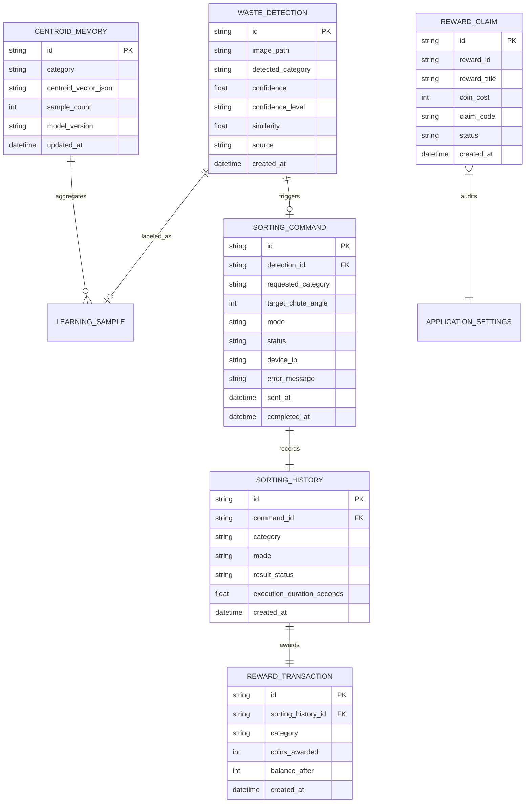

# SmartDustbin — Database Schema & Data Management

SmartDustbin uses **SQLite 3** managed via **SQLAlchemy ORM** (`storage/smartdustbin.db`). The database schema is fully normalized, indexed, and architected for seamless future migration to PostgreSQL.

---

## 1. Entity-Relationship Overview



---

## 2. Table Specifications

### A. `waste_detections`
Stores inference events from webcam, uploads, and ESP32-CAM.
- `id` (VARCHAR 36, PK): UUID.
- `image_path` (VARCHAR 255): Relative path in `storage/scans/`.
- `detected_category` (VARCHAR 20): `PLASTIC`, `METAL`, `WET`, `DRY`, `UNKNOWN`.
- `confidence` (FLOAT): Clamped confidence $[0.0, 1.0]$.
- `confidence_level` (VARCHAR 10): `HIGH`, `MEDIUM`, `LOW`.
- `similarity` (FLOAT): Pearson correlation coefficient $r \in [-1.0, 1.0]$.
- `source` (VARCHAR 50): `BROWSER_CAMERA`, `UPLOAD`, `ESP32_CAM`.
- `created_at` (DATETIME): UTC timestamp (Indexed).

### B. `sorting_commands`
Tracks every hardware or simulated sort command lifecycle.
- `id` (VARCHAR 36, PK): UUID.
- `detection_id` (VARCHAR 36, Nullable): Foreign link to scan.
- `requested_category` (VARCHAR 20): Target compartment.
- `target_chute_angle` (INTEGER): $45^\circ, 90^\circ, 135^\circ, 180^\circ$.
- `mode` (VARCHAR 20): `SIMULATION` or `REAL_HARDWARE`.
- `status` (VARCHAR 20): `PENDING`, `SENT`, `IN_PROGRESS`, `SUCCESS`, `FAILED`, `UNKNOWN`.
- `device_ip` (VARCHAR 50): IP address of sorter node.
- `error_message` (VARCHAR 255): Error explanation if failed.
- `sent_at` (DATETIME): Command dispatch timestamp.
- `completed_at` (DATETIME, Nullable): Completion timestamp.

### C. `sorting_histories`
Audit log of confirmed sorting operations.
- `id` (VARCHAR 36, PK): UUID.
- `command_id` (VARCHAR 36, UNIQUE): 1:1 link to `sorting_commands`.
- `category` (VARCHAR 20): Sorted material.
- `mode` (VARCHAR 20): `SIMULATION` or `REAL_HARDWARE`.
- `result_status` (VARCHAR 20): `SUCCESS` or `FAILED`.
- `execution_duration_seconds` (FLOAT): Routine duration ($2.7\text{ s}$).
- `created_at` (DATETIME): UTC timestamp.

### D. `reward_transactions`
Atomic coin credit ledger.
- `id` (VARCHAR 36, PK): UUID.
- `sorting_history_id` (VARCHAR 36, UNIQUE): **Strict anti-duplicate constraint.**
- `category` (VARCHAR 20): Material category.
- `coins_awarded` (INTEGER): $+5, +3, +2, +1$.
- `balance_after` (INTEGER): Running spendable balance.
- `created_at` (DATETIME): UTC timestamp.

### E. `reward_claims`
Eco Store voucher redemption history.
- `id` (VARCHAR 36, PK): UUID.
- `reward_id` (VARCHAR 20): `R1`, `R2`, `R3`, `R4`.
- `reward_title` (VARCHAR 100): Human-readable title.
- `coin_cost` (INTEGER): Cost deducted ($20, 40, 50, 100$).
- `claim_code` (VARCHAR 20, UNIQUE): Format `ECO-XXXXX`.
- `status` (VARCHAR 20): `CLAIMED` or `REDEEMED`.
- `created_at` (DATETIME): UTC timestamp.

---

## 3. Database Backup & Disaster Recovery

### Online Backup:
SmartDustbin implements non-blocking, transaction-safe SQLite backups via `sqlite3.backup()` API:
- **API Endpoint:** `POST /api/settings/backup`
- **Backup Destination:** `storage/backups/smartdustbin_backup_YYYYMMDD_HHMMSS.db`
- **Integrity Validation:** `GET /api/settings/database-health` runs `PRAGMA integrity_check`.

### Manual Backup (PowerShell):
```powershell
Copy-Item "C:\Users\Awadhesh\Desktop\SmartDustbin\storage\smartdustbin.db" "C:\Users\Awadhesh\Desktop\SmartDustbin\storage\backups\manual_backup.db"
```
