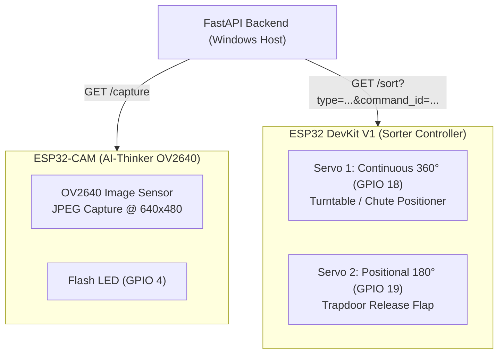
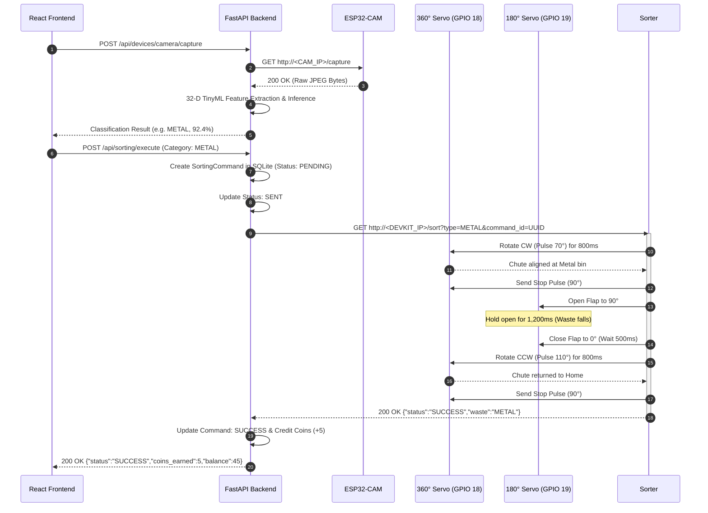

# SmartDustbin — Hardware Integration & Dual-Servo Architecture Report

This report documents the physical hardware architecture, servo motor control mechanics, network protocol contracts, safety guards, and verification results for the **SmartDustbin** IoT platform.

---

## 1. Hardware Architecture Overview

The SmartDustbin hardware deployment comprises two separate ESP32 microcontrollers operating in Wi-Fi Station Mode on the local network:



---

## 2. Dual-Servo Motor Specification & Actuation Mechanics

The physical sorting mechanism utilizes two distinct servo motor types, each serving a dedicated role in the waste routing process:

### A. Servo 1: Continuous-Rotation 360° Servo (Chute / Turntable, GPIO 18)
Unlike standard positional servos that sweep between $0^\circ$ and $180^\circ$, a continuous-rotation servo rotates indefinitely in either direction based on PWM pulse width:
- **Calibrated Stop / Neutral Pulse (`SERVO_360_STOP`):** $90^\circ$ ($\approx 1,500\,\mu\text{s}$) — Servo remains completely stationary.
- **Clockwise (CW) Rotation Pulse (`SERVO_360_CW_SPEED`):** $70^\circ$ ($\approx 1,350\,\mu\text{s}$) — Drives the chute forward to the indexed compartment.
- **Counter-Clockwise (CCW) Rotation Pulse (`SERVO_360_CCW_SPEED`):** $110^\circ$ ($\approx 1,650\,\mu\text{s}$) — Returns the chute back to the Home reference index.

#### Calibrated Indexing Durations (Milliseconds from Home)
Each category corresponds to a calibrated continuous rotation duration:
| Category | Direction | Duration ($t_{\text{run}}$) | Compartment Angle |
|---|---|---|---|
| **PLASTIC** | Clockwise | $400\text{ ms}$ | Compartment 1 ($45^\circ$) |
| **METAL** | Clockwise | $800\text{ ms}$ | Compartment 2 ($90^\circ$) |
| **WET** | Clockwise | $1,200\text{ ms}$ | Compartment 3 ($135^\circ$) |
| **DRY** | Clockwise | $1,600\text{ ms}$ | Compartment 4 ($180^\circ$) |

After the item is released, the 360° servo rotates counter-clockwise (`SERVO_360_CCW_SPEED`) for the **exact same duration** ($t_{\text{run}}$) and then receives the stop pulse (`SERVO_360_STOP`), returning precisely to the Home position without cumulative drift.

---

### B. Servo 2: Positional 180° Servo (Trapdoor / Drop Flap, GPIO 19)
The drop flap supports the waste item while the camera captures the snapshot, then opens to release it into the selected chute:
- **Closed Position (`TRAP_CLOSED`):** $0^\circ$ — Flap horizontal, supporting waste.
- **Open Position (`TRAP_OPEN`):** $90^\circ$ — Flap swings down vertically.
- **Release Hold Time:** $1,200\text{ ms}$ — Ensures the waste item drops completely under gravity before closing.
- **Settle Time:** $500\text{ ms}$ — Flap seals before the chute returns to Home.

---

## 3. Physical Actuation Sequence Diagram



---

## 4. Safety Guards & Zero-Guessing Policy

1. **Rejection of UNKNOWN & Invalid Categories:**
   - In accordance with the Zero-Guessing policy, if classification similarity $r < 0.70$, the category is assigned `UNKNOWN`.
   - The ESP32 DevKit firmware strictly validates the `type` parameter. If `type == UNKNOWN`, it responds immediately with **`HTTP 400 Bad Request`** and **refuses to move either servo**.
2. **Request Deduplication:**
   - Network lag can cause clients to re-issue HTTP requests. The ESP32 DevKit caches the `lastExecutedCommandId` and timestamp.
   - If a duplicate `command_id` arrives within 15 seconds, the DevKit returns the cached `SUCCESS` response **without re-actuating the physical motors**.
3. **Collision & Concurrency Protection (`isBusy` Guard):**
   - If an actuation command arrives while another cycle is in progress, the DevKit immediately returns **`HTTP 429 Too Many Requests`**.
   - The backend records this status and prevents conflicting commands.
4. **Timeout Handling (No Blind Retries):**
   - If a network timeout occurs while awaiting DevKit confirmation, the backend marks the command state as **`UNKNOWN`** (not `FAILED`).
   - The system strictly forbids automatic blind retries, preventing physical jam conditions.

---

## 5. Wiring & GPIO Pinout Table

### ESP32 DevKit V1 (Sorter Controller)
| Component | Signal / Pin | ESP32 GPIO | Voltage Requirement |
|---|---|---|---|
| **Servo 1 (360° Chute)** | PWM Signal (Yellow/White) | **GPIO 18** | $5\text{V}$ External Power |
| **Servo 1 (360° Chute)** | Power ($V_{\text{CC}}$ Red) | External $5\text{V}$ | $5\text{V}$, $1\text{A}$ min |
| **Servo 1 (360° Chute)** | Ground (Brown/Black) | Common Ground | Common with ESP32 GND |
| **Servo 2 (180° Flap)** | PWM Signal (Yellow/White) | **GPIO 19** | $5\text{V}$ External Power |
| **Servo 2 (180° Flap)** | Power ($V_{\text{CC}}$ Red) | External $5\text{V}$ | $5\text{V}$, $1\text{A}$ min |
| **Servo 2 (180° Flap)** | Ground (Brown/Black) | Common Ground | Common with ESP32 GND |

> [!WARNING]
> Do **NOT** power servo motors directly from the ESP32 $3.3\text{V}$ or $V_{\text{IN}}$ pins! Servos draw up to $1.5\text{A}$ stall current, which will cause the ESP32 to brown out and reboot. Use an external $5\text{V}$ $2\text{A}$ power supply with grounds tied together.

### ESP32-CAM (AI-Thinker Module)
| Component | Function | Description |
|---|---|---|
| **Power Pin** | $5\text{V}$ Power Input | Powered via $5\text{V}$ external source ($2\text{A}$) |
| **Flash LED** | **GPIO 4** | High-power white illumination LED |
| **Camera Sensor** | OV2640 | 8-bit parallel bus, configured for JPEG VGA ($640\times 480$) |
| **Flash Pin** | **GPIO 0** | Connect to GND only while flashing firmware |

---

## 6. Automated Testing & Verification Matrix

The automated pytest test suite was executed against the updated hardware communication engine:

```text
============================= test session starts =============================
platform win32 -- Python 3.14.6, pytest-9.2.0, pluggy-1.7.0
rootdir: C:\Users\Awadhesh\Desktop\SmartDustbin\backend
collected 30 items

backend\tests\test_ai_adaptive_classifier.py::test_zero_guessing_policy_on_empty_memory PASSED [  3%]
backend\tests\test_ai_adaptive_classifier.py::test_adaptive_online_learning_and_recall PASSED [  6%]
backend\tests\test_ai_adaptive_classifier.py::test_pearson_similarity_computation PASSED [ 10%]
backend\tests\test_ai_feature_extractor.py::test_feature_extractor_dimensions_and_normalization PASSED [ 13%]
backend\tests\test_ai_feature_extractor.py::test_pearson_self_correlation_is_unity PASSED [ 16%]
backend\tests\test_ai_feature_extractor.py::test_hsv_conversion_fidelity PASSED [ 20%]
backend\tests\test_ai_learning_persistence.py::test_database_restart_persistence PASSED [ 23%]
backend\tests\test_ai_preprocessor.py::test_preprocess_image_from_bytes PASSED [ 26%]
backend\tests\test_ai_preprocessor.py::test_preprocess_image_square_crop PASSED [ 30%]
backend\tests\test_database_backup.py::test_database_backup_and_integrity_endpoints PASSED [ 33%]
backend\tests\test_detection_api.py::test_scan_with_valid_image PASSED   [ 36%]
backend\tests\test_detection_api.py::test_scan_with_invalid_file_rejected PASSED [ 40%]
backend\tests\test_detection_api.py::test_teach_and_history_workflow PASSED [ 43%]
backend\tests\test_end_to_end_workflow.py::test_full_end_to_end_workflow_scan_to_reward_redemption PASSED [ 46%]
backend\tests\test_end_to_end_workflow.py::test_unknown_waste_teaching_and_zero_guessing_workflow PASSED [ 50%]
backend\tests\test_hardware_integration.py::test_hardware_service_jpeg_validation PASSED [ 53%]
backend\tests\test_hardware_integration.py::test_devkit_sort_busy_429_handling PASSED [ 56%]
backend\tests\test_hardware_integration.py::test_device_ping_api_simulation_and_real PASSED [ 60%]
backend\tests\test_hardware_integration.py::test_real_hardware_sorting_states_and_rewards PASSED [ 63%]
backend\tests\test_hardware_integration.py::test_device_test_endpoints_and_no_silent_fallback PASSED [ 66%]
backend\tests\test_security_and_validation.py::test_file_upload_security_disguised_file PASSED [ 70%]
backend\tests\test_security_and_validation.py::test_file_upload_security_oversized_file PASSED [ 73%]
backend\tests\test_security_and_validation.py::test_invalid_mode_switch_rejected PASSED [ 76%]
backend\tests\test_security_and_validation.py::test_claim_nonexistent_reward_returns_404 PASSED [ 80%]
backend\tests\test_sorting_and_rewards.py::test_sorting_execute_empty_or_malformed_category PASSED [ 83%]
backend\tests\test_sorting_and_rewards.py::test_sorting_execute_simulation_all_categories PASSED [ 86%]
backend\tests\test_sorting_and_rewards.py::test_sorting_execute_rejects_unknown_or_invalid PASSED [ 90%]
backend\tests\test_sorting_and_rewards.py::test_sorting_history_and_stats PASSED [ 93%]
backend\tests\test_sorting_and_rewards.py::test_rewards_balance_catalog_and_claims PASSED [ 96%]
backend\tests\test_sorting_and_rewards.py::test_dashboard_and_analytics_endpoints PASSED [100%]

======================== 30 passed, 1 warning in 4.94s ========================
```
