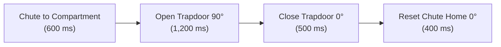

# SmartDustbin — Hardware Setup & Wiring Guide

This guide documents the physical configuration, pin connections, firmware deployment, and network requirements for the SmartDustbin dual-microcontroller setup.

---

## 1. Hardware Bill of Materials (BOM)

| Component | Quantity | Purpose |
|---|---|---|
| **AI-Thinker ESP32-CAM** | 1 | Image capture node with OV2640 camera sensor |
| **ESP32 DevKit V1 (30/36 pins)** | 1 | Dual-servo actuator controller node |
| **Standard SG90 or MG996R Servos** | 2 | Servo 1: Chute selector, Servo 2: Trapdoor flap |
| **5V 2A–3A DC Power Supply** | 1 | Dedicated power for servos and microcontrollers |
| **FTDI USB-to-TTL Adapter** | 1 | Flashing firmware to ESP32-CAM |
| **Micro-USB Cable** | 1 | Programming and powering ESP32 DevKit |
| **Breadboard & Jumper Wires** | — | Hardware interconnections |

---

## 2. Wiring & Pin Configuration

### A. ESP32 DevKit V1 (Sorter Node)
Both servos are powered by a regulated 5V power supply. **Never power high-torque servos directly from the ESP32 3.3V pin**, as voltage sag will reset the ESP32 microcontroller.

| DevKit Pin | Connection | Component |
|---|---|---|
| **GPIO 18** | PWM Signal (Orange/Yellow wire) | **Servo 1** (Direction / Chute Selector) |
| **GPIO 19** | PWM Signal (Orange/Yellow wire) | **Servo 2** (Trapdoor / Release Flap) |
| **VIN (or Ext 5V)** | VCC (Red wire) | 5V Power Supply Rail |
| **GND** | Ground (Brown/Black wire) | Common Ground (Shared with ESP32 & Servos) |

> [!IMPORTANT]
> A common ground connection between the external 5V power supply and the ESP32 DevKit GND is mandatory for PWM signal integrity.

### B. ESP32-CAM (Capture Node)
The ESP32-CAM runs the AI-Thinker OV2640 module.
- **VCC:** Connect to 5V (recommended for camera stability) or 3.3V.
- **GND:** Connect to power supply ground.
- **Flash LED:** On-board GPIO 4 (active high).

---

## 3. Servo Angle & Routine Specifications

The firmware executes a 4-step sequence lasting exactly $2,700\text{ ms}$ ($2.7\text{ s}$):



### Chute Angle Mapping:
| Waste Category | Chute Angle (GPIO 18) | Trapdoor Angle (GPIO 19) | Trapdoor Open Duration |
|---|---|---|---|
| **PLASTIC** | $45^\circ$ | $90^\circ$ | $1,200\text{ ms}$ |
| **METAL** | $90^\circ$ | $90^\circ$ | $1,200\text{ ms}$ |
| **WET** | $135^\circ$ | $90^\circ$ | $1,200\text{ ms}$ |
| **DRY** | $180^\circ$ | $90^\circ$ | $1,200\text{ ms}$ |
| **HOME / IDLE** | $0^\circ$ | $0^\circ$ (Closed) | — |

---

## 4. Firmware Flashing & Configuration

The original firmware sketches are located in:
- `D:\Smart_dustbin\smartdustbin\smartdustbin\Hardware_AI\ESP32_CAM\ESP32_CAM_Capture.ino`
- `D:\Smart_dustbin\smartdustbin\smartdustbin\Hardware_AI\ESP32_DevKit\ESP32_DevKit_Sorter.ino`

### Flashing Instructions:
1. Open Arduino IDE (v1.8.x or v2.x).
2. Install the **esp32** board package by Espressif (`https://raw.githubusercontent.com/espressif/arduino-esp32/gh-pages/package_esp32_index.json`).
3. For DevKit: Install the **ESP32Servo** library via Library Manager.
4. Set WiFi Credentials:
   ```cpp
   const char* ssid = "YOUR_WIFI_SSID";
   const char* password = "YOUR_WIFI_PASSWORD";
   ```
5. Enforce Static IPs:
   - ESP32-CAM: `192.168.4.10`
   - ESP32 DevKit: `192.168.4.20`
6. Flash ESP32-CAM: Connect GPIO 0 to GND while pressing RESET to enter download mode, upload sketch, disconnect GPIO 0 from GND, and press RESET.
7. Flash ESP32 DevKit: Select "DOIT ESP32 DEVKIT V1" and press the BOOT button when uploading begins.

---

## 5. Network Verification

Test reachability from your host computer using PowerShell:
```powershell
# Test ESP32-CAM capture
Invoke-WebRequest -Uri "http://192.168.4.10/capture" -OutFile "test.jpg"

# Test DevKit status
Invoke-RestMethod -Uri "http://192.168.4.20/status"

# Test physical sort actuation
Invoke-RestMethod -Uri "http://192.168.4.20/sort?type=PLASTIC"
```
