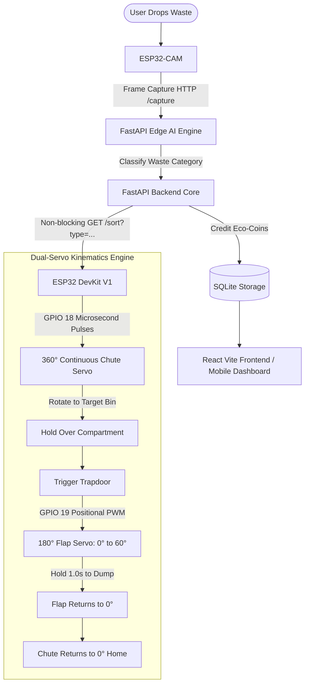

# Smart Dustbin IoT & Edge AI Presentation Kit

Use this comprehensive, slide-by-slide guide, script, and technical breakdown to present the **Smart Dustbin Autonomous Sorting System** to evaluators, professors, or clients.

---

## 1. Executive Summary & Pitch (30-Second Elevator Pitch)
> "Traditional waste disposal relies on manual segregation, which suffers from low compliance and cross-contamination. Our **Smart Dustbin** is an automated, edge-intelligent waste management platform. Using an **ESP32-CAM**, computer vision, an **ESP32 DevKit dual-servo kinematic sorting mechanism**, and a modern web dashboard with gamified **Eco-Rewards**, it autonomously identifies, classifies, and sorts waste into four distinct compartments (Plastic, Metal, Dry, Wet) in under 3 seconds with zero manual effort."

---

## 2. Presentation Slide Deck Structure

### Slide 1: Title & Introduction
- **Title:** Smart Dustbin: Autonomous Edge-AI & Dual-Servo Waste Segregator
- **Subtitle:** Closing the Loop in Urban Waste Management with IoT, Edge Vision & Gamified Incentives
- **Key Highlights:** Real Hardware Execution | Microsecond Pulse Kinematics | Zero-Hang Fail-Safe Wi-Fi | RESTful IoT Architecture

---

### Slide 2: Problem Statement & Motivation
- **The Challenge:**
  - Over 60% of recyclable materials end up in landfills due to incorrect source segregation.
  - Contamination of wet and dry waste makes recycling economically unviable.
  - Lack of user motivation to segregate waste at the point of disposal.
- **Our Solution:**
  - Point-of-disposal visual detection and automated mechanical actuation.
  - Anti-fraud reward verification: users earn digital eco-coins when waste is physically sorted and deposited.

---

### Slide 3: System Architecture & Workflow

---

### Slide 4: Hardware Engineering & Kinematic Calibration
- **Dual-Servo Kinematics:**
  1. **Continuous 360° Turntable/Chute Servo (GPIO 18):**
     - Controlled via precise microsecond timing (`writeMicroseconds`) rather than angle degrees to ensure maximum starting torque.
     - `1000 µs` = Full Clockwise (CW) rotation to target compartment.
     - `1500 µs` = Calibrated Neutral Stop.
     - `2000 µs` = Full Counter-Clockwise (CCW) return rotation.
     - Calibrated compartment travel times:
       - **Plastic:** 450 ms
       - **Metal:** 900 ms
       - **Wet:** 1350 ms
       - **Dry:** 1800 ms
  2. **Positional 180° Trapdoor Flap Servo (GPIO 19):**
     - **Closed / Home:** $0^\circ$ (holds object safely).
     - **Dump Position:** $60^\circ$ (opens downward for 1.0 second).
     - **Return:** Returns cleanly to $0^\circ$.
     - Prevents bi-directional flapping or gear binding.

---

### Slide 5: Embedded Software & Bulletproof IoT Reliability
- **Non-Blocking Immediate Socket Acknowledgment:**
  - Firmware sends HTTP 200 JSON confirmation *immediately* upon validating the command, before entering the mechanical delay loop.
  - Eliminates client socket timeouts (`500 Actuation Failed`).
- **Auto-AP Fail-Safe Network Architecture:**
  - Both ESP32-CAM and ESP32 DevKit attempt to connect to the designated Wi-Fi network (`Smartdustbin`).
  - If Wi-Fi fails to connect within 10–15 seconds, each board automatically transitions into an **Access Point (AP) mode**:
    - DevKit: `SmartDustbin_Sorter` (`192.168.4.1`)
    - CAM: `SmartDustbin_CAM` (`192.168.4.1`)
  - Ensures zero bricking or unreachable IP states during live demos.
- **Hardware Brownout Suppression:**
  - Software disables the ESP32 hardware brownout register on boot (`RTC_CNTL_BROWN_OUT_REG = 0`) to prevent reset loops from voltage sags during simultaneous Wi-Fi transmission and servo current spikes.

---

### Slide 6: Web Application & Eco-System Features
- **Modern Full-Stack Tech Stack:**
  - **Backend:** FastAPI (Python), SQLAlchemy, SQLite, Pydantic, httpx async client.
  - **Frontend:** React 18, Vite, TypeScript, Tailwind CSS, Lucide Icons.
- **Core User & Admin Modules:**
  1. **Mobile Throw Interface (`/throw`):**
     - One-click camera capture & AI review.
     - Instant manual dump shortcuts (Plastic, Metal, Dry, Wet) for immediate actuation.
     - Eco-coin celebration animations on successful dump.
  2. **Device Management & Diagnostics (`/devices`):**
     - Live IP configuration, ping latency probes, live camera preview, and hardware servo testing.
  3. **Servo Sorting Visualizer (`/sorting`):**
     - Real-time animated simulation mirroring physical servo kinematics.
  4. **Rewards & Gamification (`/rewards`):**
     - Redemption marketplace for gift cards, vouchers, and campus perks.
  5. **Dustbin QR Codes (`/qr`):**
     - Print-ready QR stickers for physical bin mounting.

---

### Slide 7: Live Demonstration Walkthrough (Demo Script)
1. **Show Hardware Setup:**
   - Point out ESP32 DevKit, 360° continuous chute servo, 180° trapdoor flap servo, and shared ground power bus.
2. **Execute Actuation:**
   - Open `/throw` or `/sorting` on mobile or laptop.
   - Click **Plastic** or **Metal**.
   - Observe: 360° servo spins clockwise to the target compartment, stops, 180° trapdoor opens to $60^\circ$, drops the item, flap seals back to $0^\circ$, and chute returns counter-clockwise back to $0^\circ$ Home.
   - Show the browser awarding coins (`+3 Coins` for Plastic, `+5 Coins` for Metal).

---

### Slide 8: Future Roadmap & Scalability
- Integration of edge TPU (TensorFlow Lite Micro on ESP32-S3).
- Ultrasonic fill-level sensors across all 4 bins with automated municipal telemetry (LoRaWAN / MQTT).
- Solar panel integration with battery power management for standalone park deployments.

---

## 3. Q&A Preparation (Common Evaluator Questions & Answers)

- **Q: Why use a 360° continuous servo instead of a stepper motor for the chute?**
  - **A:** Continuous servos offer a compact form factor, integrated gearbox, low cost, and simple 3-wire control without needing separate stepper drivers (A4988) or home limit switches. Calibrating microsecond pulses ensures accurate angular displacement with minimal complexity.

- **Q: How does the system handle power spikes when both servos and Wi-Fi transmit together?**
  - **A:** We disabled the internal brownout detector register on boot, routed an external 5V 2A–3A power supply to the servo power rails, and tied common ground with the ESP32.

- **Q: What happens if the network goes down during an exhibition?**
  - **A:** Both devices feature an automated fail-safe that turns them into independent Wi-Fi Access Points (`SmartDustbin_Sorter` and `SmartDustbin_CAM`), allowing direct control from any phone or laptop even without a router.
