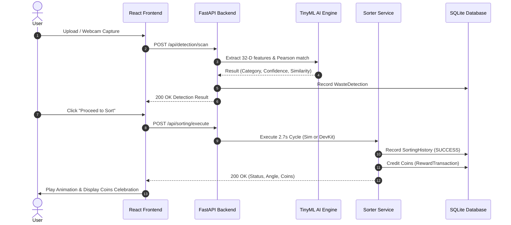

# SmartDustbin — System Architecture & Design Specification

## 1. System Architecture Overview

SmartDustbin is structured as a decoupled multi-tier IoT and AI architecture.

```mermaid
flowchart TD
    Client["React + TypeScript Web UI\n(Vite @ localhost:5173)"]
    API["FastAPI Communication Layer\n(Uvicorn @ localhost:8000)"]
    AI["TinyML AI Engine\n(OpenCV & NumPy 32-D Space)"]
    DB[("SQLite 3 Database\n(SQLAlchemy ORM)")]
    Disk[("Local Storage\n(/storage/scans & dataset)")]
    CAM["ESP32-CAM Node\n(192.168.4.10:80 /capture)"]
    DevKit["ESP32 DevKit Node\n(192.168.4.20:80 /sort)"]
    Servos["Dual Servos\n(GPIO 18 Chute / GPIO 19 Trap)"]

    Client <-->|RESTful JSON / Multipart| API
    API <-->|Feature Extraction & Matching| AI
    API <-->|CRUD & Ledger Transactions| DB
    API <-->|File Storage| Disk
    API -.->|HTTP GET Proxy (Real Mode)| CAM
    API -.->|HTTP GET /sort (Real Mode)| DevKit
    DevKit -->|PWM 50Hz| Servos
```

### Architectural Principles:
1. **Isolated Microcontroller Access:** React never connects directly to ESP32 IP addresses. FastAPI is the single source of truth and security gateway.
2. **Deterministic Fallbacks:** Simulation mode is always active by default. The system operates fully even when microcontrollers are powered down or disconnected.
3. **Mathematical Parity:** AI inference and continual learning mirror the original Unity C# TinyML algorithm with exact zero-mean unit-norm Pearson correlation.
4. **Guaranteed Transactional Integrity:** Rewards are credited only after confirmed sorting success. Unique database constraints prevent duplicate rewards.

---

## 2. Component Breakdown

### A. Frontend Layer (`frontend/src/`)
- **State Management:**
  - `HardwareContext`: Tracks active mode (`SIMULATION` vs `REAL_HARDWARE`), backend health, and microcontroller statuses.
  - `RewardsContext`: Maintains live spendable coin balance, lifetime earned, and spent counters with automatic refresh upon sorting.
- **Routing & Views:**
  - `/` — [DashboardPage](file:///C:/Users/Awadhesh/Desktop/SmartDustbin/frontend/src/pages/DashboardPage.tsx): System metrics, live activity stream, and quick shortcuts.
  - `/detection` — [DetectionPage](file:///C:/Users/Awadhesh/Desktop/SmartDustbin/frontend/src/pages/DetectionPage.tsx): Viewfinder, drag & drop upload, ESP32 trigger, UNKNOWN teaching, and direct sort trigger.
  - `/learning` — [LearningPage](file:///C:/Users/Awadhesh/Desktop/SmartDustbin/frontend/src/pages/LearningPage.tsx): 4×4 Confusion Matrix, model version, and sample deletion.
  - `/sorting` — [SortingPage](file:///C:/Users/Awadhesh/Desktop/SmartDustbin/frontend/src/pages/SortingPage.tsx): Virtual 4-compartment dustbin, SVG rotating chute, trapdoor flap, and live telemetry.
  - `/rewards` — [RewardsPage](file:///C:/Users/Awadhesh/Desktop/SmartDustbin/frontend/src/pages/RewardsPage.tsx): Eco Store catalog, instant `ECO-XXXXX` voucher generation, and transaction ledger.
  - `/analytics` — [AnalyticsPage](file:///C:/Users/Awadhesh/Desktop/SmartDustbin/frontend/src/pages/AnalyticsPage.tsx): Class distributions, success rates, and learning progress.
  - `/devices` — [DeviceManagementPage](file:///C:/Users/Awadhesh/Desktop/SmartDustbin/frontend/src/pages/DeviceManagementPage.tsx): Microcontroller configuration, latency pinging, and camera test capture.
  - `/settings` — [SettingsPage](file:///C:/Users/Awadhesh/Desktop/SmartDustbin/frontend/src/pages/SettingsPage.tsx): Network endpoints, timeouts, and SQLite backup trigger.

### B. Backend Services Layer (`backend/app/services/`)
- **`inference_service.py`:** Orchestrates image decoding, 128×128 preprocessing, 32-D feature vector extraction, memory matching, and online continual adaptation.
- **`sorting_service.py`:** Coordinates sorting commands, mode routing (Simulation vs Real Hardware), command states (`PENDING`, `SENT`, `IN_PROGRESS`, `SUCCESS`, `FAILED`, `UNKNOWN`), and triggers reward credits.
- **`rewards_service.py`:** Computes wallet balance, credits verified coins ($+5, +3, +2, +1$), redeems Eco Store vouchers, and enforces anti-duplicate checks.
- **`hardware_service.py`:** Dedicated communication layer for ESP32 devices; handles JPEG header validation, ping probes, HTTP 429 BUSY states, and timeouts.
- **`dashboard_service.py`:** Queries SQLite database directly to calculate real metrics, category distributions, and timelines without hardcoded mock data.

---

## 3. Data Flow Diagrams

### Detection to Sorting & Rewards Pipeline:

