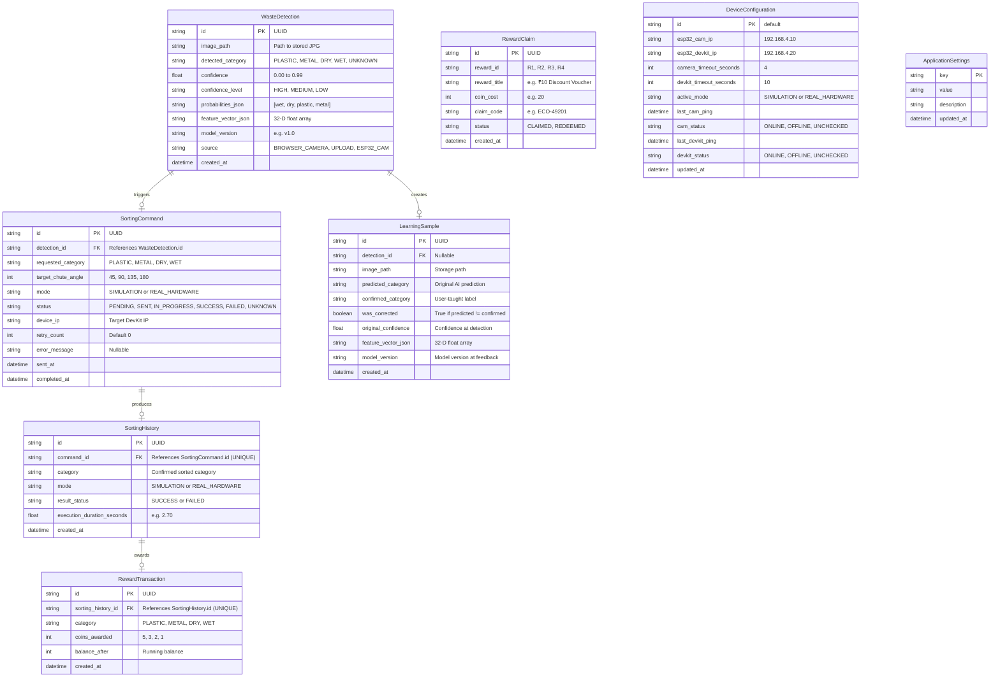

# SMARTDUSTBIN SYSTEM ARCHITECTURE & IMPLEMENTATION PLAN
**Document Version:** 1.0.0  
**Phase:** Phase 2 — Architecture and Planning  
**Target Root:** `C:\Users\Awadhesh\Desktop\SmartDustbin`  
**Reference Repository:** `D:\Smart_dustbin\smartdustbin\smartdustbin`  

---

## 1. EXECUTIVE OVERVIEW

This document establishes the end-to-end technical blueprint for replacing the legacy Unity-based SmartDustbin mobile application with a complete, production-grade web application. 

The architecture guarantees:
1. **Mathematical Parity with Unity TinyML AI:** 32-D spatial/spectral feature extraction, Pearson standard-space correlation ($r \in [-1, 1]$), 1-shot online centroid adaptation, and zero-guessing policy ($r < 0.70 \to \text{UNKNOWN}$).
2. **True Microcontroller Hardware Integration:** ESP32-CAM for wireless JPEG image capture; ESP32 DevKit V1 for physical dual-servo sorting actuation (GPIO 18 Chute, GPIO 19 Trapdoor).
3. **Strict Separation of Concerns:**
   - **Simulation Mode (Default):** Zero physical device dependency; virtual chute and trapdoor CSS/Canvas animations; synthetic yet realistic hardware telemetry; real SQLite persistence; real AI classification.
   - **Real Hardware Mode:** FastAPI backend communicates with ESP32-CAM (`/capture`) and ESP32 DevKit (`/sort`, `/status`); real hardware status; strict command delivery and deduplication.
4. **Relational Database Foundation:** SQLite for local Windows zero-config operations, structured via SQLAlchemy ORM for future PostgreSQL portability.
5. **Verified Reward Economy:** Strict credit only after confirmed physical/simulated sorting (+5 Metal, +3 Plastic, +2 Dry, +1 Wet) with anti-duplicate transaction protection and in-app Eco Store claim redemptions (`ECO-XXXXX`).

---

## 2. HIGH-LEVEL APPLICATION ARCHITECTURE

```
                                  +-----------------------------------------------+
                                  |                 WEB BROWSER                   |
                                  |         (React + Vite + TypeScript)           |
                                  +-----------------------+-----------------------+
                                                          | HTTP REST / JSON
                                                          v
+-----------------------------------------------------------------------------------------------------------------+
|                                              FASTAPI BACKEND SERVICE                                            |
|                                                                                                                 |
|  +--------------------+   +--------------------+   +--------------------+   +--------------------------------+  |
|  |   API Layer        |   |   Business Core    |   |   AI Engine        |   |   Hardware / Simulation Layer  |  |
|  | - /api/dashboard   |   | - DetectionService |   | - Preprocessor     |   | - ESP32CameraService           |  |
|  | - /api/detection   |   | - LearningService  |   |   (128x128 Crop)   |   | - ESP32ControllerService       |  |
|  | - /api/learning    |   | - SortingService   |   | - FeatureExtractor |   | - SimulationManager            |  |
|  | - /api/sorting     |   | - RewardsService   |   |   (32-D Vector)    |   | - HardwareManager (Mode Gate)  |  |
|  | - /api/rewards     |   | - DeviceService    |   | - AdaptiveMemory   |   +---------------+----------------+  |
|  | - /api/devices     |   | - SettingsService  |   |   (Centroids/k-NN) |                   |                   |
|  +--------------------+   +--------------------+   +--------------------+                   |                   |
|             |                       |                        |                              |                   |
+-------------|-----------------------|------------------------|------------------------------|-------------------+
              |                       |                        |                              |
              v                       v                        v                              v
   +----------------------+   +---------------+    +------------------------+   +-------------------------------+
   |   SQLite Database    |   | Local Storage |    | Persistent AI Memory   |   | WiFi Microcontroller Devices  |
   | (SQLAlchemy Models)  |   | (storage/)    |    | (model/centroids.json) |   |                               |
   | - waste_detections   |   | - scans/      |    | (model/features.json)  |   | 1. ESP32-CAM (192.168.4.10)   |
   | - learning_samples   |   | - dataset/    |    +------------------------+   |    GET /capture (JPEG Frame)  |
   | - sorting_commands   |   +---------------+                                 |                               |
   | - sorting_histories  |                                                     | 2. ESP32 DevKit (192.168.4.20)|
   | - reward_txns        |                                                     |    GPIO 18: Chute (0°-180°)   |
   | - reward_claims      |                                                     |    GPIO 19: Trapdoor (0°-90°) |
   | - device_configs     |                                                     |    GET /sort?type=...         |
   | - app_settings       |                                                     |    GET /status                |
   +----------------------+                                                     +-------------------------------+
```

---

## 3. DATABASE SCHEMA & RELATIONSHIPS

The database uses SQLite initially, with SQLAlchemy ORM models configured with standard types and UTC timestamps to guarantee portability to PostgreSQL.



### Key Integrity Constraints:
1. `RewardTransaction.sorting_history_id` is unique: impossible to award coins twice for a single sorting operation.
2. `SortingHistory.command_id` is unique: one sorting command produces exactly one historical record.
3. Every transaction records `created_at` in UTC ISO-8601 string format.

---

## 4. COMPLETE BACKEND REST API SPECIFICATION

All endpoints are prefixed with `/api`. Standard HTTP status codes (200, 201, 400, 404, 409, 429, 500) and structured Pydantic schemas are enforced.

### 4.1 Dashboard Endpoints
* **`GET /api/dashboard/stats`**
  * **Response:**
    ```json
    {
      "total_detected": 142,
      "total_sorted": 138,
      "category_counts": {
        "PLASTIC": 48,
        "METAL": 32,
        "DRY": 35,
        "WET": 23,
        "UNKNOWN": 4
      },
      "total_learned_samples": 18,
      "current_coin_balance": 340,
      "active_mode": "SIMULATION",
      "cam_status": "SIMULATED",
      "devkit_status": "SIMULATED",
      "model_version": "v1.0",
      "estimated_accuracy": 91.2
    }
    ```
* **`GET /api/dashboard/recent-activity`**
  * **Response:** Recent 10 detections and recent 10 sorting operations.

### 4.2 Waste Detection Endpoints
* **`POST /api/detection/scan`**
  * **Content-Type:** `multipart/form-data`
  * **Form Fields:** `file` (UploadFile), `source` (`"BROWSER_CAMERA"` | `"UPLOAD"` | `"ESP32_CAM"`)
  * **Behavior:** Saves image in `storage/scans/`, runs 128x128 crop, extracts 32-D feature vector, computes Pearson similarity against centroids and exemplars.
  * **Response:**
    ```json
    {
      "detection_id": "c1f7b5...-...",
      "image_url": "/api/static/scans/scan_20261123_120530.jpg",
      "category": "PLASTIC",
      "confidence": 0.94,
      "confidence_level": "HIGH",
      "probabilities": { "WET": 0.01, "DRY": 0.02, "PLASTIC": 0.95, "METAL": 0.02 },
      "is_known_in_memory": true,
      "model_version": "v1.0",
      "requires_user_label": false
    }
    ```
* **`GET /api/detection/history`**
  * **Query Params:** `limit=50`, `offset=0`, `category=Optional[str]`
  * **Response:** Paginated list of detection records.

### 4.3 Continual AI Learning Endpoints
* **`POST /api/learning/teach`**
  * **Body:**
    ```json
    {
      "detection_id": "c1f7b5...-...",
      "confirmed_category": "METAL"
    }
    ```
  * **Behavior:**
    1. Loads feature vector of `detection_id`.
    2. Updates online class centroid: $C_{\text{new}} = (C_{\text{old}} \cdot N + F) / (N + 1)$.
    3. Adds vector to persistent `FeatureStore`.
    4. Copies/moves cropped image to `storage/dataset/METAL/`.
    5. Checks if sample batch threshold (20) is met; bumps version to `v1.x` if triggered.
    6. Returns updated model state.
* **`GET /api/learning/samples`**
  * **Query Params:** `category=Optional[str]`, `limit=50`
  * **Response:** Labeled training samples with thumbnail URLs and correction status.
* **`DELETE /api/learning/samples/{sample_id}`**
  * **Behavior:** Safe removal of sample and recalculation of class centroids.
* **`POST /api/learning/reset`**
  * **Behavior:** Resets centroids and exemplar memory to baseline.

### 4.4 Sorting Control Endpoints
* **`POST /api/sorting/execute`**
  * **Body:**
    ```json
    {
      "detection_id": "c1f7b5...-...",
      "category": "PLASTIC",
      "mode_override": null
    }
    ```
  * **Behavior:**
    1. Generates unique `command_id`.
    2. Validates category ($\in \{\text{PLASTIC}, \text{METAL}, \text{DRY}, \text{WET}\}$). Rejects `UNKNOWN`.
    3. Checks `DeviceConfiguration.active_mode`:
       * If `SIMULATION`: runs simulated 2.7s sequence (Chute to 45°, trapdoor open 1.2s, close, return home), returns simulated success, awards coins.
       * If `REAL_HARDWARE`: checks DevKit availability (`/status`). If busy, returns HTTP 429. If online, issues `GET http://<IP>/sort?type=PLASTIC`. On verified `{"status":"SUCCESS"}`, updates database, awards coins.
  * **Response:**
    ```json
    {
      "command_id": "f89d...",
      "status": "SUCCESS",
      "category": "PLASTIC",
      "target_angle": 45,
      "mode": "SIMULATION",
      "coins_earned": 3,
      "message": "Sorting executed successfully"
    }
    ```
* **`GET /api/sorting/history`**
  * **Response:** Paginated sorting events with timestamps, durations, and statuses.
* **`GET /api/sorting/commands/{command_id}`**
  * **Response:** State of a specific sorting command (`PENDING`, `IN_PROGRESS`, `SUCCESS`, etc.).

### 4.5 Rewards & Eco Store Endpoints
* **`GET /api/rewards/balance`**
  * **Response:**
    ```json
    {
      "balance": 340,
      "total_earned": 380,
      "total_spent": 40
    }
    ```
* **`GET /api/rewards/history`**
  * **Response:** List of reward transactions (+5, +3, +2, +1).
* **`GET /api/rewards/catalog`**
  * **Response:** 4 Eco Store reward items with coin costs.
* **`POST /api/rewards/claim`**
  * **Body:** `{ "reward_id": "R1" }`
  * **Behavior:** Checks balance $\ge$ cost, deducts coins, generates `ECO-XXXXX` claim code, returns receipt.
* **`GET /api/rewards/claims`**
  * **Response:** List of user's claimed voucher codes and timestamps.

### 4.6 Device Management & Camera Capture Endpoints
* **`GET /api/devices/status`**
  * **Behavior:** Concurrently checks ESP32-CAM and ESP32 DevKit availability if in Real Hardware mode, or reports simulated state if in Simulation mode.
* **`POST /api/devices/camera/capture`**
  * **Behavior:** In Real Hardware mode, backend calls `http://<ESP32_CAM_IP>/capture` with 4s timeout, validates JPEG header, saves frame to `storage/scans/`, returns scan image URL. In Simulation mode, captures a synthetic test frame.
* **`POST /api/devices/test-connection`**
  * **Body:** `{ "device": "DEVKIT" | "CAM", "ip": "192.168.4.20" }`
  * **Behavior:** Non-actuating ping (`GET /status` or `GET /capture`). Safe: does not operate servos.
* **`POST /api/devices/mode`**
  * **Body:** `{ "mode": "SIMULATION" | "REAL_HARDWARE" }`
  * **Behavior:** Explicit mode switch with safety validation.

### 4.7 Settings Endpoints
* **`GET /api/settings`** & **`PUT /api/settings`**
  * Read and update ESP32 IPs, timeouts, camera preferences, and operational defaults.

---

## 5. FRONTEND PAGE & COMPONENT STRUCTURE

Built with **React (TypeScript), Vite, Tailwind CSS, React Router, Lucide Icons, and Recharts**.

```text
frontend/src/
├── components/
│   ├── layout/
│   │   ├── AppLayout.tsx               # Primary layout with responsive sidebar & header
│   │   ├── Header.tsx                  # Mode pill badge, coin balance widget, status indicator
│   │   ├── Sidebar.tsx                 # Navigation links with active indicator and icons
│   │   └── ToastContainer.tsx          # Non-blocking animated alert notifications
│   ├── dashboard/
│   │   ├── StatCard.tsx                # Metric card (value, icon, change indicator)
│   │   ├── CategoryBreakdownChart.tsx  # Donut / Bar chart for waste categories
│   │   ├── DeviceStatusPill.tsx        # Camera & DevKit connection status pills
│   │   └── RecentActivityList.tsx      # Combined timeline of detections and sortings
│   ├── detection/
│   │   ├── CameraViewfinder.tsx        # HTML5 navigator.mediaDevices webcam feed
│   │   ├── ImageDropzone.tsx           # Drag-and-drop JPEG/PNG file uploader
│   │   ├── DetectionResultCard.tsx     # Large category badge, confidence meter, probability bars
│   │   └── UnknownTeachingModal.tsx    # Category selection prompt (WET/DRY/PLASTIC/METAL)
│   ├── sorting/
│   │   ├── VirtualDustbin.tsx          # 2D/3D SVG interactive waste chute visualizer
│   │   ├── ServoAngleGauge.tsx         # Real-time dial showing 0° to 180° chute direction
│   │   ├── TrapdoorAnimation.tsx       # Animated trapdoor opening (90°) and closing (0°)
│   │   └── SortingProgressStepper.tsx  # Step indicator (Target Angle -> Chute -> Drop -> Reset)
│   ├── learning/
│   │   ├── ConfusionMatrix4x4.tsx      # 4x4 matrix grid (Predicted vs Actual) with heatmap colors
│   │   ├── LearnedSamplesTable.tsx     # Gallery of user-taught samples with delete/view actions
│   │   └── ModelVersionBadge.tsx       # Version pill (v1.0 -> v1.x) with sample count
│   ├── rewards/
│   │   ├── CoinBalanceCard.tsx         # Animated coin display with earned/spent breakdown
│   │   ├── EcoStoreCard.tsx            # Claimable reward item with "Claim Reward" action
│   │   └── ClaimCodeModal.tsx          # Modal displaying generated ECO-XXXXX voucher code
│   └── devices/
│       ├── DeviceCard.tsx              # IP input, status badge, "Ping Device" button
│       └── ModeSwitchModal.tsx         # Confirmation dialog before switching to Real Hardware
├── context/
│   ├── HardwareContext.tsx             # Holds active_mode, device statuses, ping helpers
│   └── RewardsContext.tsx              # Real-time coin balance state and refresh listener
├── pages/
│   ├── DashboardPage.tsx               # High-level overview, statistics, system health
│   ├── DetectionPage.tsx               # Browser camera / upload / ESP32-CAM classification
│   ├── LearningPage.tsx                # Continual learning analytics, sample manager, teach UI
│   ├── SortingPage.tsx                 # Virtual dustbin animation and sorting actuation control
│   ├── RewardsPage.tsx                 # Eco Store, coin balance, claim vouchers
│   ├── AnalyticsPage.tsx               # Detailed charts, historical trends, confusion matrix
│   ├── DeviceManagementPage.tsx        # Hardware IP config, connection pings, mode toggling
│   └── SettingsPage.tsx                # System preferences and threshold configuration
├── services/
│   ├── api.ts                          # Central Axios client with base URL & interceptors
│   ├── detectionService.ts             # Image upload, scan endpoint caller
│   ├── sortingService.ts               # Sort execution caller
│   ├── learningService.ts              # Feedback submission & sample management
│   ├── rewardsService.ts               # Balance, catalog, claim transactions
│   └── deviceService.ts                # Hardware status and ping caller
├── types/
│   └── api.ts                          # TypeScript interfaces matching backend Pydantic models
├── App.tsx                             # Route definitions & Context providers
└── main.tsx                            # React root mount
```

---

## 6. BACKEND SERVICE STRUCTURE & ARCHITECTURE

FastAPI application follows the **Repository & Service Pattern**:

```text
backend/app/
├── ai/
│   ├── preprocessor.py          # Image center-crop, 128x128 resize, [0, 1] normalization
│   ├── feature_extractor.py     # NumPy 32-D feature vector extractor (exact math port)
│   ├── adaptive_classifier.py   # Centroids, k-NN exemplars, Pearson similarity calculation
│   └── memory_store.py          # JSON/file storage of centroids and feature vectors
├── core/
│   ├── config.py                # Pydantic BaseSettings (DB URL, storage paths, defaults)
│   ├── database.py              # SQLAlchemy engine, session maker, get_db dependency
│   └── security.py              # File validation, size limits, input sanitization
├── hardware/
│   ├── esp32_cam_service.py     # Async HTTP client for ESP32-CAM /capture
│   ├── esp32_devkit_service.py  # Async HTTP client for ESP32 DevKit /sort & /status
│   ├── simulation_manager.py    # Simulated servo timing, chute angles, synthetic responses
│   └── hardware_manager.py      # Facade delegating to Simulation or Real Hardware services
├── models/                      # SQLAlchemy ORM declarations
│   ├── detection.py
│   ├── learning.py
│   ├── sorting.py
│   ├── reward.py
│   └── device.py
├── schemas/                     # Pydantic request & response models
│   ├── detection.py
│   ├── learning.py
│   ├── sorting.py
│   ├── reward.py
│   └── device.py
├── services/                    # Business orchestration services
│   ├── detection_service.py
│   ├── learning_service.py
│   ├── sorting_service.py
│   ├── rewards_service.py
│   └── device_service.py
├── api/                         # FastAPI routers
│   ├── routes_dashboard.py
│   ├── routes_detection.py
│   ├── routes_learning.py
│   ├── routes_sorting.py
│   ├── routes_rewards.py
│   ├── routes_devices.py
│   └── routes_settings.py
└── main.py                      # FastAPI app initialization, CORS, static mounts
```

---

## 7. AI MIGRATION IMPLEMENTATION PLAN

### Feature Extractor Porting Details (`feature_extractor.py`):
1. **Input:** Image array of shape $(128, 128, 3)$ with values in $[0.0, 1.0]$ in RGB order.
2. **Color Conversion:**
   - Convert to HSV space using OpenCV `cv2.cvtColor` (or vectorized NumPy), scaling $H \in [0.0, 1.0)$, $S \in [0.0, 1.0]$, $V \in [0.0, 1.0]$.
3. **Bin Accumulators:**
   - 8 Hue bins: $\lfloor H \times 8 \rfloor$ clamped to $[0, 7]$.
   - 4 Saturation bins: $\lfloor S \times 4 \rfloor$ clamped to $[0, 3]$.
   - 4 Value bins: $\lfloor V \times 4 \rfloor$ clamped to $[0, 3]$.
4. **Spatial Quadrants ($2 \times 2$):**
   - $Q_0$: $x \in [0, 63], y \in [0, 63]$
   - $Q_1$: $x \in [64, 127], y \in [0, 63]$
   - $Q_2$: $x \in [0, 63], y \in [64, 127]$
   - $Q_3$: $x \in [64, 127], y \in [64, 127]$
   - Accumulate $H$, $S$, and edge gradient $\Delta$ per quadrant.
5. **Horizontal Edge Gradient:**
   - $\Delta(x, y) = |V(x, y) - (0.299 R_{x+1, y} + 0.587 G_{x+1, y} + 0.114 B_{x+1, y})|$.
6. **Material Signatures:**
   - Specular (Metal): $S < 0.15 \land V > 0.60$.
   - Chlorophyll (Wet/Bio): $0.18 < H < 0.45 \land S > 0.25$.
   - Edge roughness (Dry/Paper): Total edge energy / $N$.
   - Color variance: $\sum (|R - G| + |G - B|) / N$.
7. **Pearson Embedding Normalization:**
   - Mean-center: $F - \mu$.
   - Unit-norm: divide by $\sqrt{\sum (F_i - \mu)^2}$.
8. **Parity Testing:** A dedicated Python test script (`tests/test_ai_parity.py`) will evaluate synthetic solid and patterned test images to verify identical dimension matching, normalization, and similarity outputs.

---

## 8. ESP32 HARDWARE INTEGRATION PLAN

### ESP32-CAM Integration:
- In Real Hardware Mode, the frontend or user clicks "Capture from ESP32-CAM".
- Frontend calls FastAPI `POST /api/devices/camera/capture`.
- FastAPI `ESP32CameraService` issues asynchronous `httpx.get("http://192.168.4.10/capture", timeout=4.0)`.
- Validates JPEG SOI marker (`\xFF\xD8`).
- Saves frame to `storage/scans/` and returns URL to frontend.
- Frontend displays captured frame in the viewfinder and auto-triggers detection.

### ESP32 DevKit Dual-Servo Actuation:
- Frontend initiates sort request: `POST /api/sorting/execute` with `{ "category": "PLASTIC" }`.
- FastAPI creates `SortingCommand` with UUID in database, status `SENT`.
- FastAPI `ESP32ControllerService` sends `GET http://192.168.4.20/sort?type=PLASTIC` with a 10-second timeout.
- ESP32 DevKit executes internal physical routine:
  1. Direction servo rotates to 45° (Plastic) — 600 ms.
  2. Trapdoor servo opens to 90° — 1200 ms.
  3. Trapdoor servo closes to 0° — 500 ms.
  4. Direction servo returns to Home (0°) — 400 ms.
- ESP32 DevKit returns `{"status":"SUCCESS","waste":"PLASTIC","message":"Sorted successfully"}`.
- FastAPI verifies JSON, sets `SortingCommand.status = "SUCCESS"`, writes `SortingHistory`, credits +3 coins in `RewardTransaction`.
- Frontend receives 200 OK, transitions UI to Success Screen, updates coin balance.

---

## 9. SIMULATION AND REAL HARDWARE MODE DESIGN

| Aspect | Simulation Mode (Default) | Real Hardware Mode |
| :--- | :--- | :--- |
| **Physical ESP32 Required** | No | Yes (ESP32-CAM at 192.168.4.10, DevKit at 192.168.4.20) |
| **Camera Feed** | Browser Webcam or Uploaded Image | Live ESP32-CAM WiFi stream / capture |
| **AI Classification** | Real Python 32-D TinyML Engine | Real Python 32-D TinyML Engine |
| **Sorting Actuation** | Virtual animated Chute (0°-180°) & Trapdoor (0°-90°) | Physical DevKit GPIO 18 & GPIO 19 dual-servo routine |
| **Actuation Duration** | Realistic 2.7-second animation timer | Actual 2.7-second physical cycle + network latency |
| **Device Status Display** | Clearly badged: `SIMULATED (Ready)` | Real ping response: `ONLINE` or `OFFLINE` |
| **History & Rewards** | Saved to SQLite DB, marked as `SIMULATION` | Saved to SQLite DB, marked as `REAL_HARDWARE` |
| **Safety Guard** | Mode can be switched anytime | Switching to Real Hardware validates IP reachability |

---

## 10. TESTING STRATEGY

1. **AI Unit & Parity Tests:**
   - 32-D dimension verification.
   - Mean-centering verification: $\sum \hat{F} \approx 0$.
   - Unit-length verification: $\sum \hat{F}^2 \approx 1.0$.
   - Known material memory recall: $r \ge 0.70 \to \text{KNOWN}$.
   - Unknown material rejection: $r < 0.70 \to \text{UNKNOWN}$.
   - Online centroid update formula mathematical verification.
2. **Backend API Tests:**
   - Health check response (`/api/health`).
   - Image upload and scan validation (`/api/detection/scan`).
   - Sorting command execution in simulation mode (`/api/sorting/execute`).
   - Reward credit deduplication (confirm unique constraint blocks repeated rewards).
   - Eco Store redemption and claim code verification.
3. **End-to-End Workflow Verification:**
   - Browser Webcam / File Upload $\to$ 32-D AI Detection $\to$ Unknown Teach Modal $\to$ Virtual Sorting $\to$ Reward Balance Increment.

---

## 11. PHASE-WISE IMPLEMENTATION CHECKLIST

- [x] **Phase 1: Existing Project Audit** (Complete, documented in `SMARTDUSTBIN_MIGRATION_AUDIT.md`)
- [x] **Phase 2: Architecture and Planning** (Complete, documented in `SMARTDUSTBIN_ARCHITECTURE_PLAN.md`)
- [ ] **Phase 3: Project Setup** (Next immediate step)
  - [ ] Initialize backend folder structure and virtual environment.
  - [ ] Install backend dependencies (FastAPI, Uvicorn, SQLAlchemy, NumPy, OpenCV, HTTPX).
  - [ ] Configure SQLite database and base models.
  - [ ] Implement core health and settings API endpoints.
  - [ ] Initialize React + Vite + TypeScript frontend.
  - [ ] Install and configure Tailwind CSS and Lucide icons.
  - [ ] Build responsive application layout (Sidebar, Header with Mode pill, Navigation routes).
  - [ ] Connect frontend to backend via Axios client and verify end-to-end communication.
- [ ] **Phase 4: AI & Waste Detection Engine** (Port 32-D TinyML, camera/upload inputs, zero-guessing, online learning)
- [ ] **Phase 5: Sorting Simulation & Reward Economy** (Virtual chute/trapdoor, reward transactions, Eco Store claims, analytics)
- [ ] **Phase 6: Real ESP32 Hardware Integration** (ESP32-CAM adapter, DevKit dual-servo dispatcher, timeout protection)
- [ ] **Phase 7: End-to-End Testing & Documentation** (Parity test suite, setup guides, PowerShell launch scripts)
