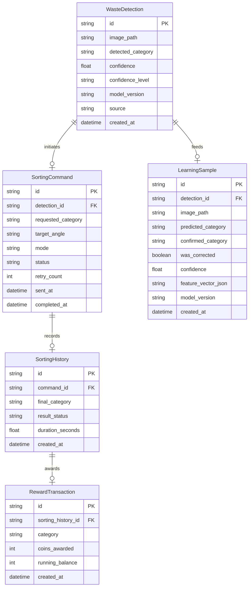

# SMARTDUSTBIN MIGRATION AUDIT REPORT
**Document Version:** 1.0.0  
**Audit Date:** November 23, 2026  
**Auditor:** Senior Software Architect, IoT Integration Engineer & AI Lead  
**Inspected Project Root:** `D:\Smart_dustbin\smartdustbin\smartdustbin`  
**Target Web Application Directory:** `C:\Users\Awadhesh\Desktop\SmartDustbin`  

---

## 1. EXECUTIVE SUMMARY & SOURCE REPOSITORY DISCOVERY

A thorough inspection of the filesystem was conducted. The original Unity SmartDustbin project was located at:
```text
D:\Smart_dustbin\smartdustbin\smartdustbin\
```
Every single component referenced in the project requirements exists in this repository:
- **Unity Scripts (`Assets/Scripts/`):** 21 C# source files covering AI runtime, online continual learning, camera streaming, network controllers, UI management, rewards, and editor tools.
- **Hardware Firmware (`Hardware_AI/`):** Full Arduino `.ino` sketches for both ESP32-CAM and ESP32 DevKit dual-servo sorter.
- **Legacy AI Server (`Hardware_AI/AI_Server/`):** A standalone FastAPI prototype (`ai_server.py`).
- **Unity Scenes (`Assets/Scenes/`):** 7 scene assets including `SMARTDUSTBIN.unity`, `New Scene 2.unity`, and `SampleScene.unity`.

### Critical Finding: The AI Implementation Discrepancy
In the original repository:
1. `Hardware_AI/AI_Server/ai_server.py` is a rudimentary prototype that relied either on an absent PyTorch `.pth` file or fell back to random dominant-color heuristics.
2. **The TRUE, sophisticated SmartDustbin AI classification algorithm was implemented entirely in Unity C# (`TinyMLInference.cs`, `AdaptiveClassifier.cs`, `FeatureStore.cs`, `LearningManager.cs`).** It extracts a 32-dimensional spectral/spatial feature vector, maps it into a mean-centered Pearson standard space ($r \in [-1, 1]$), performs 1-shot online centroid adaptation, and enforces a strict zero-guessing policy ($r < 0.70 \to \text{UNKNOWN}$).
3. **Migration Strategy:** We must port the verified C# mathematical algorithm directly to Python/NumPy/OpenCV in the FastAPI backend, completely replacing the naive heuristic in `ai_server.py`.

---

## 2. EXISTING ARCHITECTURE & REPOSITORY COMPONENT BREAKDOWN

```
D:\Smart_dustbin\smartdustbin\smartdustbin\
├── Assets/
│   ├── Scripts/
│   │   ├── AI/
│   │   │   ├── Configuration/
│   │   │   │   └── AIConfig.cs              # Hyperparameters (128x128, thresholds 0.80/0.60, blend weights)
│   │   │   ├── Data/
│   │   │   │   ├── WasteCategory.cs         # Enum: UNKNOWN (-1), WET (0), DRY (1), PLASTIC (2), METAL (3)
│   │   │   │   └── WastePrediction.cs       # Prediction data transfer object (probabilities, confidence, featureVector)
│   │   │   ├── Learning/
│   │   │   │   ├── AdaptiveClassifier.cs    # Online nearest-centroid & k-NN exemplar matcher
│   │   │   │   ├── DatasetManager.cs        # JPEG image storage & metadata logging (storage policy)
│   │   │   │   ├── FeatureStore.cs          # Raw exemplar vector persistence
│   │   │   │   ├── LearningManager.cs       # Continual learning orchestrator, accuracy & confusion matrix
│   │   │   │   └── TrainingSample.cs        # Individual sample record schema
│   │   │   └── Runtime/
│   │   │       ├── ConfidenceCalculator.cs  # Multi-tiered confidence evaluation (High, Medium, Low)
│   │   │       ├── ImagePreprocessor.cs     # Center-crop, 128x128 bilinear resize, [0, 1] normalization
│   │   │       ├── ModelOutputParser.cs     # Softmax argmax and prediction packing
│   │   │       └── TinyMLInference.cs       # 32-D feature extraction & Pearson correlation inference
│   │   ├── Camera/
│   │   │   └── ESP32Camera.cs               # Multi-camera switcher (WebCamTexture, ESP32-CAM stream, Mock feed)
│   │   ├── Config/
│   │   │   └── NetworkConfig.cs             # IP management, QR code schema parser, Mock mode toggle
│   │   ├── Core/
│   │   │   └── MainController.cs            # 12-state Finite State Machine (FSM), auto-wiring, flow control
│   │   ├── Data/
│   │   │   └── WasteResult.cs               # Data structures (WasteResult, SortResponse, AIResponse)
│   │   ├── Editor/
│   │   │   └── SetupSmartDustbinScene.cs    # Automated Unity UI hierarchy builder and component binder
│   │   ├── ESP32/
│   │   │   └── ESP32GatewayClient.cs        # Alternative gateway client for ESP32 DevKit
│   │   ├── Network/
│   │   │   ├── AIManager.cs                 # Switcher between On-Device AI and remote AI server
│   │   │   ├── ESP32Controller.cs          # HTTP client for ESP32 DevKit (/sort?type=..., /status)
│   │   │   ├── OnDeviceWasteClassifier.cs   # Coroutine-based local classifier wrapper
│   │   │   └── QRScannerManager.cs          # WebCam QR scanner with animated reticle
│   │   └── UI/
│   │       ├── ClaimManager.cs              # Eco-reward catalog, claim code generation (ECO-XXXXX)
│   │       ├── CoinManager.cs               # Material-based coin reward balance (+5, +3, +2, +1)
│   │       ├── DetectionUI.cs               # UI for high-confidence vs unknown prompt
│   │       ├── LearningUI.cs                # Confusion matrix (4x4) and dataset metrics dashboard
│   │       ├── StatusManager.cs             # Global status text & timed toasts
│   │       └── UIManager.cs                 # 11-panel screen router and settings modal
│   └── Scenes/
│       ├── SMARTDUSTBIN.unity               # Primary production scene
│       └── New Scene 2.unity                # Configured 9-screen UI layout
├── Hardware_AI/
│   ├── AI_Server/
│   │   ├── ai_server.py                     # Legacy FastAPI prototype
│   │   └── requirements.txt                 # fastapi, uvicorn, pydantic, pillow, torch
│   ├── ESP32_CAM/
│   │   └── ESP32_CAM_Capture.ino            # AI-Thinker ESP32-CAM firmware (HTTP /capture)
│   └── ESP32_DevKit/
│       └── ESP32_DevKit_Sorter.ino          # ESP32 DevKit V1 dual-servo sorter firmware (HTTP /sort, /status)
└── README.md                                # Project architecture & hardware wiring specification
```

---

## 3. FEATURE INVENTORY & CURRENT IMPLEMENTATION STATUS

| Feature | Original Implementation | Status in Unity Project | Web Migration Plan |
| :--- | :--- | :--- | :--- |
| **Image Capture** | `ESP32Camera.cs` (WebCamTexture & HTTP stream) | Implemented | Browser `navigator.mediaDevices.getUserMedia` + ESP32-CAM HTTP proxy |
| **AI Preprocessing** | `ImagePreprocessor.cs` | Implemented (128x128 bilinear crop) | Ported to Python OpenCV (`cv2.resize`, center-crop) |
| **32-D Feature Extraction** | `TinyMLInference.cs` | Implemented (Histograms + Quadrants + Signatures) | Ported identically to Python NumPy |
| **Cosine/Pearson Matching** | `AdaptiveClassifier.cs` | Implemented ($r \ge 0.70$ threshold) | Ported to Python NumPy |
| **Zero-Guessing Policy** | `TinyMLInference.cs` | Implemented (Forces UNKNOWN if $r < 0.70$) | Preserved strictly in FastAPI AI engine |
| **1-Shot Continual Learning** | `AdaptiveClassifier.cs`, `LearningManager.cs` | Implemented (Online centroid update) | Ported to backend persistent SQLite/JSON store |
| **Dataset Storage** | `DatasetManager.cs` | Implemented (JPEG files + `metadata_log.json`) | Ported to backend local file storage + DB metadata |
| **Chute Servo (Motor 1)** | `ESP32_DevKit_Sorter.ino` (GPIO 18) | Implemented in firmware | Managed via FastAPI `ESP32ControllerService` |
| **Trapdoor Servo (Motor 2)** | `ESP32_DevKit_Sorter.ino` (GPIO 19) | Implemented in firmware | Managed via FastAPI `ESP32ControllerService` |
| **Physical Sorting API** | `ESP32Controller.cs` (`GET /sort?type=...`) | Implemented | Backend REST endpoint `/api/sorting/execute` |
| **Hardware Concurrency** | `ESP32_DevKit_Sorter.ino` (`isBusy` flag) | Implemented (returns 429 if busy) | Backend command locking & UUID tracking |
| **Reward Coin Engine** | `CoinManager.cs` | Implemented (+5 Metal, +3 Plastic, +2 Dry, +1 Wet) | Database-backed transactions with duplicate protection |
| **Reward Claim Store** | `ClaimManager.cs` | Implemented (Vouchers, Drinks, Tree, UPI) | Web-based Eco Store with claim tracking |
| **Confusion Matrix (4x4)** | `LearningManager.cs`, `LearningUI.cs` | Implemented (Calculated from historical samples) | Dynamic SVG/Chart.js 4x4 matrix on Analytics page |
| **Simulation Mode** | `NetworkConfig.cs` (`useMockHardware`) | Implemented (synthetic delays & responses) | Dedicated UI Simulation mode with animated Chute/Trapdoor |
| **Database Persistence** | Unity `PlayerPrefs` & JSON files | **Partially Implemented (Fragile)** | Upgraded to robust Relational SQLite / SQLAlchemy |
| **QR Device Pairing** | `QRScannerManager.cs` | Implemented for mobile | Replaced with Web Device Settings & direct IP configuration |

---

## 4. AI CLASSIFICATION SYSTEM & WORKFLOW AUDIT

### Evidence Source Files:
- `D:\Smart_dustbin\smartdustbin\smartdustbin\Assets\Scripts\AI\Runtime\ImagePreprocessor.cs`
- `D:\Smart_dustbin\smartdustbin\smartdustbin\Assets\Scripts\AI\Runtime\TinyMLInference.cs`
- `D:\Smart_dustbin\smartdustbin\smartdustbin\Assets\Scripts\AI\Runtime\ModelOutputParser.cs`
- `D:\Smart_dustbin\smartdustbin\smartdustbin\Assets\Scripts\AI\Runtime\ConfidenceCalculator.cs`
- `D:\Smart_dustbin\smartdustbin\smartdustbin\Assets\Scripts\AI\Configuration\AIConfig.cs`
- `D:\Smart_dustbin\smartdustbin\smartdustbin\Assets\Scripts\AI\Data\WasteCategory.cs`

### Preprocessing Pipeline:
1. **Input:** Raw image bytes (JPEG / PNG).
2. **Center-Crop:** Aspect ratio normalized by taking $\min(\text{width}, \text{height})$ from the image center:
   $$\text{cropSize} = \min(W, H), \quad X_{\text{start}} = \frac{W - \text{cropSize}}{2}, \quad Y_{\text{start}} = \frac{H - \text{cropSize}}{2}$$
3. **Resize:** Bilinear interpolation to $128 \times 128$ RGB.
4. **Channel Normalization:** Pixel channels are normalized to $[0.0, 1.0]$.

### 32-Dimensional Feature Vector Specification:
The feature vector $F \in \mathbb{R}^{32}$ is computed per pixel across the $128 \times 128$ image ($N = 16,384$ pixels):

| Index Range | Dimension | Name | Exact Extraction Formula |
| :--- | :--- | :--- | :--- |
| **0 – 7** | 8 | **Hue Histogram** | HSV conversion ($H \in [0, 1)$). 8 bins: $h_{\text{bin}} = \text{clamp}(\lfloor H \times 8 \rfloor, 0, 7)$. Normalized by $N$. |
| **8 – 11** | 4 | **Saturation Histogram** | HSV conversion ($S \in [0, 1]$). 4 bins: $s_{\text{bin}} = \text{clamp}(\lfloor S \times 4 \rfloor, 0, 3)$. Normalized by $N$. |
| **12 – 15** | 4 | **Value/Brightness Histogram** | HSV conversion ($V \in [0, 1]$). 4 bins: $v_{\text{bin}} = \text{clamp}(\lfloor V \times 4 \rfloor, 0, 3)$. Normalized by $N$. |
| **16 – 19** | 4 | **Quadrant Mean Hue** | Image partitioned into $2 \times 2$ grid ($Q_0$: TL, $Q_1$: TR, $Q_2$: BL, $Q_3$: BR). Accumulates $H$ per quadrant, divided by quadrant pixel count $N_q$. |
| **20 – 23** | 4 | **Quadrant Mean Saturation** | Accumulates $S$ per quadrant, divided by $N_q$. |
| **24 – 27** | 4 | **Quadrant Edge Energy** | Horizontal gradient using standard luminance weights: $\Delta = \|V(x,y) - (0.299 R_{x+1} + 0.587 G_{x+1} + 0.114 B_{x+1})\|$. Accumulates per quadrant, divided by $N_q$. |
| **28** | 1 | **Specular / Metallic Signature** | Highlights specular reflection characteristic of metal cans/foils: count of pixels with $S < 0.15 \land V > 0.60$, divided by $N$. |
| **29** | 1 | **Green Chlorophyll Signature** | Indicator for organic/wet waste: count of pixels with $0.18 < H < 0.45 \land S > 0.25$, divided by $N$. |
| **30** | 1 | **Total Edge Energy (Roughness)** | Total edge gradient $\sum \Delta$ divided by $N$ (distinguishes crumpled dry paper/cardboard). |
| **31** | 1 | **Color Variance** | Sum of inter-channel absolute differences: $\sum (\|R - G\| + \|G - B\|) / N$ (indicative of printed multi-colored plastics). |

### Pearson Standard-Space Normalization:
To eliminate magnitude bias, the 32 raw features are mean-centered and unit-normalized:
$$\mu = \frac{1}{32} \sum_{i=0}^{31} F_i, \quad \tilde{F}_i = F_i - \mu$$
$$\sigma = \sqrt{\sum_{i=0}^{31} \tilde{F}_i^2}$$
$$\hat{F}_i = \frac{\tilde{F}_i}{\sigma} \quad (\text{if } \sigma > 10^{-4})$$
Because $\hat{F}$ is zero-mean and unit-length, the dot product $\hat{F}_A \cdot \hat{F}_B$ is mathematically equivalent to the **Pearson Correlation Coefficient** $r \in [-1, 1]$.

### Inference & Zero-Guessing Rule:
1. Memory query: $\hat{F}$ is compared against:
   - The centroid vector $\mu_{\text{cat}}$ of each category (`AdaptiveClassifier.cs`).
   - All historical exemplar vectors in `FeatureStore.cs` ($k$-NN check).
2. The maximum similarity $r_{\max} = \max(\text{sim}_{\text{centroid}}, \text{sim}_{\text{exemplar}})$ is identified.
3. **Decision Boundary:**
   - If $r_{\max} \ge 0.70$ and matched category $\neq \text{UNKNOWN}$:
     $$\text{Confidence} = \text{clamp}(r_{\max}, 0.90, 0.99)$$
     Classified as high-confidence known material.
   - If $r_{\max} < 0.70$ or no memory exists:
     $$\text{Category} = \text{UNKNOWN}, \quad \text{Confidence} = 0.0, \quad \text{Probabilities} = [0.25, 0.25, 0.25, 0.25]$$
     **Zero guessing is enforced.** The system halts automatic sorting and prompts the user to label the item.

---

## 5. UNKNOWN MATERIAL & CONTINUAL LEARNING WORKFLOW AUDIT

### Evidence Source Files:
- `D:\Smart_dustbin\smartdustbin\smartdustbin\Assets\Scripts\AI\Learning\AdaptiveClassifier.cs`
- `D:\Smart_dustbin\smartdustbin\smartdustbin\Assets\Scripts\AI\Learning\FeatureStore.cs`
- `D:\Smart_dustbin\smartdustbin\smartdustbin\Assets\Scripts\AI\Learning\DatasetManager.cs`
- `D:\Smart_dustbin\smartdustbin\smartdustbin\Assets\Scripts\AI\Learning\LearningManager.cs`
- `D:\Smart_dustbin\smartdustbin\smartdustbin\Assets\Scripts\AI\Learning\TrainingSample.cs`

### Online Centroid Adaptation (1-Shot Learning):
When a user confirms or corrects a category $C \in \{\text{WET}, \text{DRY}, \text{PLASTIC}, \text{METAL}\}$:
1. `AdaptiveClassifier.UpdateCentroidWithSample(C, \hat{F})`:
   $$C_{\text{new}} = \frac{C_{\text{old}} \cdot N + \hat{F}}{N + 1}, \quad N_{\text{new}} = N + 1$$
2. The updated centroid is immediately saved to disk (`classifier.json`), enabling instantaneous 1-shot learning for the very next scan.
3. `FeatureStore.AddFeatureVector(C, \hat{F})`: Appends the 32-D vector to `feature_store.json` for persistent $k$-NN memory.
4. `DatasetManager.SaveConfirmedSample(...)`: Saves the cropped image as `sample_{timestamp}_{random}.jpg` inside `dataset/{CATEGORY}/` and records metadata in `metadata_log.json`.

### Model Versioning and Retraining:
- After every 20 feedback samples (`samplesBeforeUpdate = 20` in `AIConfig.cs`), `LearningManager.TriggerModelUpdate()` triggers.
- Model version advances: `v1.0` $\to$ `v1.1` $\to$ `v1.2` etc.
- All centroids are re-computed globally by averaging all vectors in `FeatureStore`.
- Accuracy estimate is updated based on historical non-corrected vs corrected samples:
  $$\text{Accuracy} = \frac{N_{\text{correct}}}{N_{\text{total}}} \times 100\%$$
- 4x4 Confusion Matrix is recalculated by crossing predicted category vs user-confirmed category.

---

## 6. REWARD CALCULATION & GAMIFIED ECONOMY LOGIC

### Evidence Source Files:
- `D:\Smart_dustbin\smartdustbin\smartdustbin\Assets\Scripts\UI\CoinManager.cs`
- `D:\Smart_dustbin\smartdustbin\smartdustbin\Assets\Scripts\UI\ClaimManager.cs`
- `D:\Smart_dustbin\smartdustbin\smartdustbin\Assets\Scripts\Core\MainController.cs`

### Coin Allocation Rules:
Coins are awarded **only upon verified completion of a physical sorting cycle**:
- 🪙 **METAL:** **+5 coins** (highest value recyclable)
- 🪙 **PLASTIC:** **+3 coins** (standard recyclable)
- 🪙 **DRY / Paper:** **+2 coins** (biodegradable/recyclable paper)
- 🪙 **WET / Organic:** **+1 coin** (compostable food waste)
- Default / Other: +1 coin

### Anti-Fraud & Deduplication Rule:
In `MainController.cs` (lines 400–415), coins are added **strictly inside `case DustbinState.Success:`** which is reached only when `ESP32Controller` triggers `OnSortingSuccess`. No coins are ever awarded on QR scan, image upload, or failed/timed-out sorting.

### Eco Store Claim Catalog:
`ClaimManager.cs` defines a 4-tier redemption structure:
1. `R1`: "₹10 Discount Voucher" — 20 coins
2. `R2`: "Free Coffee / Drink" — 40 coins
3. `R3`: "Plant 1 Tree (Eco Donation)" — 50 coins
4. `R4`: "₹50 UPI Cashback" — 100 coins

Redemption generates a randomized code: `ECO-XXXXX` (e.g. `ECO-48291`) and deducts coins from the user's balance.

---

## 7. ESP32-CAM IMAGE CAPTURE WORKFLOW & FIRMWARE AUDIT

### Evidence Source Files:
- `D:\Smart_dustbin\smartdustbin\smartdustbin\Hardware_AI\ESP32_CAM\ESP32_CAM_Capture.ino`
- `D:\Smart_dustbin\smartdustbin\smartdustbin\Assets\Scripts\Camera\ESP32Camera.cs`
- `D:\Smart_dustbin\smartdustbin\smartdustbin\Assets\Scripts\Config\NetworkConfig.cs`

### Hardware & Network Configuration:
- **Board:** AI-Thinker ESP32-CAM module (OV2640 sensor).
- **Default Static IP:** `192.168.4.10`, Port `80`.
- **Subnet:** `255.255.255.0`, Gateway: `192.168.4.1`.
- **Flash LED:** GPIO `4`.

### Firmware Endpoints:
1. `GET /`: Returns HTML status confirmation ("Smart Dustbin ESP32-CAM is Online").
2. `GET /capture`:
   - Captures active frame buffer from OV2640 sensor.
   - Headers sent:
     - `Content-Type: image/jpeg`
     - `Access-Control-Allow-Origin: *`
   - Returns raw binary JPEG stream.
   - Resolution: `FRAMESIZE_VGA` ($640 \times 480$) if PSRAM detected, else `FRAMESIZE_QVGA` ($320 \times 240$). JPEG quality set to 10 (high quality).

### Integration Handling in Web:
The browser cannot always directly fetch from an insecure HTTP local IP due to browser Mixed Content policies when hosted. The FastAPI backend must act as a reliable proxy client:
- Backend provides `POST /api/devices/camera/capture` which connects to `http://<ESP32_CAM_IP>/capture` with a configurable 4-second timeout, validates the JPEG payload, and returns it to the web client.

---

## 8. ESP32 DEVKIT SORTING MECHANISM WORKFLOW & FIRMWARE AUDIT

### Evidence Source Files:
- `D:\Smart_dustbin\smartdustbin\smartdustbin\Hardware_AI\ESP32_DevKit\ESP32_DevKit_Sorter.ino`
- `D:\Smart_dustbin\smartdustbin\smartdustbin\Assets\Scripts\Network\ESP32Controller.cs`
- `D:\Smart_dustbin\smartdustbin\smartdustbin\Assets\Scripts\Config\NetworkConfig.cs`

### Hardware & Pin Configuration:
- **Board:** ESP32 DevKit V1 (30/36 pin).
- **Default Static IP:** `192.168.4.20`, Port `80`.
- **Servo Motor 1 (Chute / Direction Selector):** Signal attached to `GPIO 18`.
- **Servo Motor 2 (Trapdoor / Waste Drop Flap):** Signal attached to `GPIO 19`.
- **PWM Timers:** ESP32PWM allocateTimer(0..3), 50 Hz PWM period.

### Chute Angle Mapping (Motor 1):
- `DIR_HOME` = $0^\circ$ (Neutral / standby)
- `DIR_PLASTIC` = $45^\circ$
- `DIR_METAL` = $90^\circ$
- `DIR_WET` = $135^\circ$
- `DIR_DRY` = $180^\circ$

### Trapdoor Flap Mapping (Motor 2):
- `TRAP_CLOSED` = $0^\circ$ (Closed, holds waste item on detection platform)
- `TRAP_OPEN` = $90^\circ$ (Rotated down, drops waste into chosen chute compartment)

### Complete Actuation Sequence (`executeSorting` in `.ino`):
```text
[Step 1] servoDirection.write(targetAngle)  --> Rotate chute to 45°/90°/135°/180°
         delay(600 ms)                      --> Settle chute into compartment position
[Step 2] servoTrapdoor.write(90°)           --> Open trapdoor flap
         delay(1200 ms)                     --> Waste drops under gravity
[Step 3] servoTrapdoor.write(0°)            --> Close trapdoor flap
         delay(500 ms)                      --> Settle trapdoor
[Step 4] servoDirection.write(0°)           --> Return chute to neutral home position
         delay(400 ms)                      --> Settle chute
Total Physical Routine Execution Duration: 2,700 ms (2.7 seconds)
```

### Firmware Endpoints:
1. `GET /status`:
   - Returns JSON: `{"device":"ESP32_DevKit_Sorter","status":"ONLINE","busy":false}`
2. `GET /sort?type=<PLASTIC|METAL|WET|DRY>`:
   - If `isBusy == true`: Returns HTTP `429` with `{"status":"BUSY","message":"Sorter is currently executing another cycle."}`
   - If `type` missing: Returns HTTP `400` with `{"status":"ERROR","message":"Missing 'type' parameter in query string."}`
   - When executed: Returns HTTP `200` with `{"status":"SUCCESS","waste":"PLASTIC","message":"Sorted successfully"}`
   - Both handlers explicitly attach header: `Access-Control-Allow-Origin: *`.

---

## 9. ELECTRICAL CONSIDERATIONS & SAFETY PRACTICES

### Critical Hardware Safety Requirements:
1. **Independent Servo Power:** Two standard hobby servos (SG90 or MG996R) draw surge currents between 500mA and 2.5A when accelerating. **Servos must NEVER be powered from the ESP32 3.3V or 5V (VIN) rail.** An external regulated 5V (2A–3A) power supply must power the servos.
2. **Common Ground:** The ground (`GND`) of the external 5V power supply, the ESP32 DevKit, and the ESP32-CAM must all be tied together. Failure to establish a common ground causes jittering and erratic servo triggering.
3. **Emergency Disarm:** The web application and backend must support an immediate emergency abort/stop command that cancels pending hardware requests.

---

## 10. UNITY UI SCREEN INVENTORY & FSM MAPPING

### State Machine in `MainController.cs`:
`DustbinState` enum contains 12 states:
`Connecting`, `ScanningQR`, `Idle`, `Scanning`, `Classifying`, `WaitingForConfirmation`, `Sorting`, `Success`, `ManualControl`, `ClaimRewards`, `LearningDashboard`, `Error`.

### Screen Panels in `UIManager.cs`:
1. **Connection Screen (`connectionPanel`):** Displays device connectivity status, retry buttons, and offline simulation toggle.
2. **QR Scan Screen (`qrScanPanel`):** Camera view for scanning config QR codes (e.g. WiFi IP payloads).
3. **Home Screen (`homePanel`):** Navigation hub with coin balance and primary action triggers.
4. **Camera / Scan Screen (`cameraPanel`):** Live viewfinder with camera cycling and "Capture & Scan" button.
5. **Detection Screen (`detectionPanel`):** Contains `HighConfidencePanel` (one-click confirm for recognized items) and `LowMedConfidencePanel` / `CorrectionPanel` (4 category buttons: WET, DRY, PLASTIC, METAL to teach the AI).
6. **Sorting Screen (`sortingPanel`):** Displays sorting animation with active waste label.
7. **Success Screen (`successPanel`):** Displays sorted item name, coin reward earned, and continue button.
8. **Manual Control Screen (`manualPanel`):** Diagnostic screen with 4 manual servo test buttons.
9. **Claim Rewards Screen (`claimPanel`):** In-app Eco Store with balance display and claimable reward cards.
10. **Learning Dashboard (`learningDashboardPanel`):** Model version, sample counts per category, estimated accuracy, and 4x4 Confusion Matrix.
11. **Settings Modal (`settingsPanel`):** Inputs for ESP32-CAM IP, ESP32 DevKit IP, AI Server URL, and Mock Hardware toggle.

---

## 11. REUSABLE SOURCE FILES & LOGIC

| File / Component | Reusability | Migration Action |
| :--- | :--- | :--- |
| `TinyMLInference.cs` (Feature extraction math) | 100% Logic Reusable | Translate 32-D extraction equations directly to Python NumPy/OpenCV |
| `AdaptiveClassifier.cs` (Centroid & Cosine matching) | 100% Logic Reusable | Port centroid calculation and Pearson similarity matrix to Python |
| `CoinManager.cs` (Reward valuation) | 100% Logic Reusable | Implement in Python `rewards_service.py` with DB transaction logging |
| `ClaimManager.cs` (Catalog & Claim codes) | 100% Logic Reusable | Implement in Python `rewards_service.py` with DB claim table |
| `ESP32_CAM_Capture.ino` | 100% Firmware Reusable | Retain Arduino firmware without modification |
| `ESP32_DevKit_Sorter.ino` | 100% Firmware Reusable | Retain Arduino firmware without modification |
| `SetupSmartDustbinScene.cs` / `UIManager.cs` | UI Specification Reusable | Convert 11 panel layouts into modern React + Tailwind components |

---

## 12. MISSING, PARTIAL, OR PROBLEMATIC FEATURES IN ORIGINAL UNITY IMPLEMENTATION

1. **AI Implementation Split:** The Unity client had the real feature extractor, whereas `ai_server.py` had a dummy script. We must unify this completely in the FastAPI backend.
2. **Persistence Vulnerability:** Unity relied on `PlayerPrefs` and loose JSON files (`ai_state.json`, `metadata_log.json`). If files were corrupted or cleared, all learning was lost. We will use a proper SQLAlchemy SQLite database.
3. **No Sorting Command Tracking:** The Unity app sent fire-and-forget HTTP GET requests to `/sort?type=...` with no unique request ID. If an HTTP timeout occurred, the app assumed failure even if the DevKit was executing the command. We will introduce a unique UUID for every sorting command with state tracking (`PENDING`, `SENT`, `IN_PROGRESS`, `SUCCESS`, `FAILED`, `UNKNOWN`).
4. **Missing Camera Capture Web APIs:** Unity used `WebCamTexture`. Web applications require modern HTML5 Canvas and `navigator.mediaDevices.getUserMedia`.

---

## 13. UNITY-TO-WEB MIGRATION MAPPING

```
┌──────────────────────────────────────┐          ┌──────────────────────────────────────┐
│       ORIGINAL UNITY ARCHITECTURE     │          │      NEW MODERN WEB ARCHITECTURE     │
├──────────────────────────────────────┤          ├──────────────────────────────────────┤
│ MainController (C# FSM)              │  ═════>  │ React Router + React Context State   │
│ UIManager (11 Panels)                │  ═════>  │ Responsive Tailwind UI Components    │
│ ESP32Camera (WebCamTexture)          │  ═════>  │ WebRTC Navigator Camera + ESP32 API  │
│ TinyMLInference (C# 32-D Vector)     │  ═════>  │ Python / NumPy AI Feature Extractor  │
│ AdaptiveClassifier (Centroids)       │  ═════>  │ Python Adaptive Learning Engine      │
│ DatasetManager (JSON + JPEGs)        │  ═════>  │ FastAPI Storage + SQLite / DB Model  │
│ CoinManager (+5, +3, +2, +1)         │  ═════>  │ SQLAlchemy Rewards Transaction Log   │
│ ClaimManager (Eco Store)             │  ═════>  │ React Rewards Page & Backend Claims  │
│ LearningUI (4x4 Confusion Matrix)    │  ═════>  │ Dynamic Analytics Visualizer Matrix  │
│ ESP32Controller (UnityWebRequest)    │  ═════>  │ FastAPI httpx ESP32 Controller Client│
│ ESP32_CAM_Capture.ino                │  ═════>  │ Unchanged Physical Firmware          │
│ ESP32_DevKit_Sorter.ino              │  ═════>  │ Unchanged Physical Firmware          │
└──────────────────────────────────────┘          └──────────────────────────────────────┘
```

---

## 14. PROPOSED WEB APPLICATION ARCHITECTURE

### Directory Structure:
```text
C:\Users\Awadhesh\Desktop\SmartDustbin\
├── backend/
│   ├── app/
│   │   ├── ai/
│   │   │   ├── feature_extractor.py     # Ported 32-D feature vector extractor
│   │   │   ├── adaptive_classifier.py   # Centroids, exemplars, Pearson matching
│   │   │   ├── preprocessor.py          # 128x128 center-crop & normalization
│   │   │   └── memory_store.py          # Persistent model vectors & versioning
│   │   ├── api/
│   │   │   ├── routes_dashboard.py      # /api/dashboard/stats
│   │   │   ├── routes_detection.py      # /api/detection/scan, /api/detection/history
│   │   │   ├── routes_learning.py       # /api/learning/teach, /api/learning/samples
│   │   │   ├── routes_sorting.py        # /api/sorting/execute, /api/sorting/commands
│   │   │   ├── routes_rewards.py        # /api/rewards/balance, /api/rewards/history
│   │   │   ├── routes_devices.py        # /api/devices/status, /api/devices/camera/capture
│   │   │   └── routes_settings.py       # /api/settings
│   │   ├── core/
│   │   │   ├── config.py                # Environment configuration
│   │   │   └── database.py              # SQLAlchemy engine & session factory
│   │   ├── hardware/
│   │   │   ├── esp32_cam_service.py     # Camera snapshot client & timeout handler
│   │   │   ├── esp32_devkit_service.py  # Dual-servo actuation command dispatcher
│   │   │   ├── simulation_manager.py    # Simulated virtual chute/trapdoor logic
│   │   │   └── hardware_manager.py      # Mode selector (Simulation vs Real Hardware)
│   │   ├── models/                      # SQLAlchemy ORM models
│   │   │   ├── detection.py             # WasteDetection
│   │   │   ├── learning.py              # LearningSample, CentroidMemory
│   │   │   ├── sorting.py               # SortingCommand, SortingHistory
│   │   │   ├── reward.py                # RewardTransaction, RewardClaim
│   │   │   └── settings.py              # DeviceConfig, AppSettings
│   │   ├── schemas/                     # Pydantic schemas for request/response
│   │   ├── services/                    # Business logic services
│   │   └── main.py                      # FastAPI application entrypoint
│   ├── tests/
│   │   ├── test_ai_parity.py            # AI mathematical parity verification
│   │   ├── test_sorting_service.py      # Sorting workflow & duplicate checks
│   │   └── test_rewards_service.py      # Coin calculation verification
│   └── requirements.txt
├── frontend/
│   ├── src/
│   │   ├── components/
│   │   │   ├── common/                  # Navbar, Sidebar, Card, Badge, Modal, Toast
│   │   │   ├── dashboard/               # StatCard, RecentActivityTable, StatusIndicator
│   │   │   ├── detection/               # CameraViewfinder, ImageUploader, DetectionBadge
│   │   │   ├── sorting/                 # VirtualDustbinAnimation, ChuteTrapdoorVisualizer
│   │   │   ├── learning/                # ConfusionMatrixGrid, CategoryBarChart
│   │   │   └── rewards/                 # BalanceCard, EcoStoreCatalog, ClaimHistory
│   │   ├── context/
│   │   │   ├── HardwareContext.tsx      # Hardware vs Simulation mode state
│   │   │   └── RewardsContext.tsx       # Coin balance & real-time updates
│   │   ├── pages/
│   │   │   ├── DashboardPage.tsx
│   │   │   ├── DetectionPage.tsx
│   │   │   ├── LearningPage.tsx
│   │   │   ├── SortingPage.tsx
│   │   │   ├── RewardsPage.tsx
│   │   │   ├── AnalyticsPage.tsx
│   │   │   ├── DeviceManagementPage.tsx
│   │   │   └── SettingsPage.tsx
│   │   ├── services/                    # Axios API client functions
│   │   ├── types/                       # TypeScript interfaces
│   │   ├── App.tsx
│   │   └── main.tsx
│   ├── package.json
│   ├── tailwind.config.js
│   ├── tsconfig.json
│   └── vite.config.ts
├── storage/                             # Uploaded images, dataset samples, models
└── SMARTDUSTBIN_MIGRATION_AUDIT.md
```

### Proposed Database Entity Relationship Diagram:


---

## 15. RISKS & MITIGATION STRATEGY

| Risk | Impact | Mitigation Plan |
| :--- | :--- | :--- |
| **Float/Bilinear Interpolation Parity Differences** | Python OpenCV resize may differ slightly from Unity C# bilinear sampler, yielding micro-variations in 32-D features. | Standardize RGB to HSV conversion formulas and construct a test suite checking tolerance ($\epsilon < 0.02$) between C# and Python features. |
| **Mixed Content Restrictions in Web Browsers** | Modern browsers block HTTP requests to `192.168.4.x` if the web app is served over HTTPS or different origins. | All communication with ESP32-CAM and ESP32 DevKit is routed exclusively through the FastAPI backend server (`httpx`). The browser only talks to FastAPI. |
| **Network Timeout During Physical Sorting** | Physical sorting takes 2.7s. If the network drops during the cycle, the frontend might report failure while the waste was actually sorted. | The backend assigns a unique `command_id` and tracks states: `PENDING`, `SENT`, `IN_PROGRESS`, `SUCCESS`, `FAILED`, `UNKNOWN`. If disconnected mid-flight, state remains `UNKNOWN` until health ping recovers device status. |
| **Duplicate Reward Exploitation** | Rapid duplicate clicks could award multiple coins for a single sorting operation. | Enforce database-level unique constraint on `sorting_history_id` in `RewardTransaction` table; coins are credited strictly once. |
| **Browser Camera Permissions** | Camera access might be denied on mobile or desktop browsers. | Provide dual input: live browser camera and clean drag-and-drop file upload, with clear permission status messages. |

---

## 16. QUESTIONS REQUIRING YOUR CONFIRMATION BEFORE PROCEEDING

Before we proceed to Phase 2 (Architecture & Planning) and Phase 3 (Project Setup), please confirm your preference on the following points:

1. **AI Porting Confirmation:** Do you approve porting the exact 32-D TinyML feature extraction algorithm and online centroid learning from Unity C# into Python/NumPy, replacing the simplistic heuristic in `ai_server.py`?
2. **Default Operating Mode:** Shall we set **Simulation Mode** as the default when starting the web app, allowing full testing of AI detection, virtual chute/trapdoor animations, learning, and rewards without requiring physical ESP32 boards to be powered on?
3. **Database Selection:** We recommend SQLite for local development (zero configuration required on Windows), structured via SQLAlchemy so you can switch to PostgreSQL with a single configuration flag later. Do you approve this?
4. **Reward Values:** Do you confirm the reward table:
   - Metal: +5 coins
   - Plastic: +3 coins
   - Dry: +2 coins
   - Wet: +1 coin
   - Eco Store redemption codes (`ECO-XXXXX`)?

---

### End of Phase 1 Audit
*The audit is complete and documented. The original Unity project remains completely untouched. Awaiting your explicit approval to proceed to Phase 2.*
