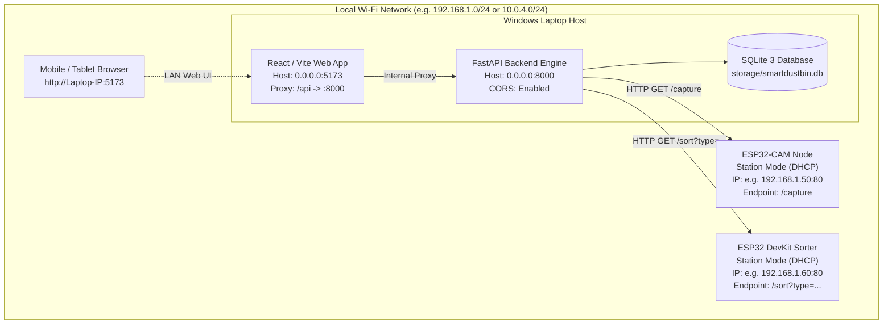

# SmartDustbin — Windows Local Network Deployment Guide

This guide details how to run the complete **SmartDustbin** full-stack system locally on a Windows laptop, enabling communication across your Local Area Network (LAN) between the FastAPI backend, the React/Vite web application, and the physical **ESP32-CAM** and **ESP32 DevKit** microcontrollers.

---

## 1. System Architecture Overview



---

## 2. Prerequisites & Software Requirements

1. **Operating System:** Windows 10 or Windows 11 (64-bit).
2. **Python:** Python 3.10 to 3.14 (Anaconda or official Python distribution).
3. **Node.js:** Node.js v18.x, v20.x, or v22+ (`node -v` and `npm -v`).
4. **Arduino IDE 2.x:** For flashing the ESP32 microcontrollers.
   - Install **ESP32 Board Support** via Board Manager (`esp32` by Espressif Systems).
   - Install **ESP32Servo** library via Library Manager.
5. **Local Network:** A Wi-Fi router or Mobile Hotspot supporting 2.4 GHz (ESP32 only connects to 2.4 GHz).

---

## 3. Windows Firewall Configuration

To ensure your ESP32 microcontrollers and LAN devices can reach your laptop:

1. Open PowerShell as Administrator.
2. Run the following commands to allow inbound traffic on ports **8000** (FastAPI) and **5173** (Vite):

```powershell
# Allow FastAPI Backend Port 8000
New-NetFirewallRule -DisplayName "SmartDustbin Backend (FastAPI)" -Direction Inbound -LocalPort 8000 -Protocol TCP -Action Allow -Profile Private

# Allow Vite Frontend Port 5173
New-NetFirewallRule -DisplayName "SmartDustbin Frontend (Vite)" -Direction Inbound -LocalPort 5173 -Protocol TCP -Action Allow -Profile Private
```

> [!NOTE]
> Make sure your current Wi-Fi network profile is set to **Private** in Windows Settings (*Network & Internet -> Wi-Fi -> Network profile type -> Private*).

---

## 4. One-Click Launch (Recommended)

Run the included launch script from PowerShell:

```powershell
cd C:\Users\Awadhesh\Desktop\SmartDustbin
.\start-smartdustbin.ps1
```

### What this script does:
1. Detects your laptop's current active Wi-Fi LAN IP (e.g. `10.0.4.232` or `192.168.1.x`).
2. Activates the Python virtual environment at `backend\venv`.
3. Launches FastAPI listening on `0.0.0.0:8000` in a dedicated console window.
4. Launches Vite listening on `0.0.0.0:5173` in a dedicated console window.
5. Displays a connection table showing both local and LAN addresses.
6. Automatically opens your default web browser to `http://localhost:5173`.

---

## 5. Manual Startup (Alternative)

If you prefer to start services individually:

### Terminal 1: Backend
```powershell
cd C:\Users\Awadhesh\Desktop\SmartDustbin
.\backend\venv\Scripts\python.exe backend\run.py
```
- Local URL: `http://127.0.0.1:8000`
- Swagger Docs: `http://127.0.0.1:8000/docs`

### Terminal 2: Frontend
```powershell
cd C:\Users\Awadhesh\Desktop\SmartDustbin\frontend
npm run dev
```
- Local URL: `http://localhost:5173`
- Network URL: `http://<LAN_IP>:5173`

---

## 6. Accessing the System from Another Device on LAN

Because both servers bind to `0.0.0.0`, any device (such as a smartphone, tablet, or another computer) connected to the same Wi-Fi network can access the SmartDustbin platform:

1. Identify your laptop's Wi-Fi IP address (printed by `start-smartdustbin.ps1` or run `ipconfig`).
2. On your phone/tablet browser, open:
   ```
   http://<LAPTOP_LAN_IP>:5173
   ```
3. The Vite development server automatically proxies all `/api` calls directly to `http://127.0.0.1:8000/api` on the laptop host, providing full access without extra CORS configuration.

---

## 7. Stopping the Platform

To shut down the servers:
- Close the two PowerShell console windows labeled for FastAPI and Vite, or press `Ctrl + C` inside each window.
- The SQLite database and all trained AI memory will remain safely saved in `storage/smartdustbin.db`.
